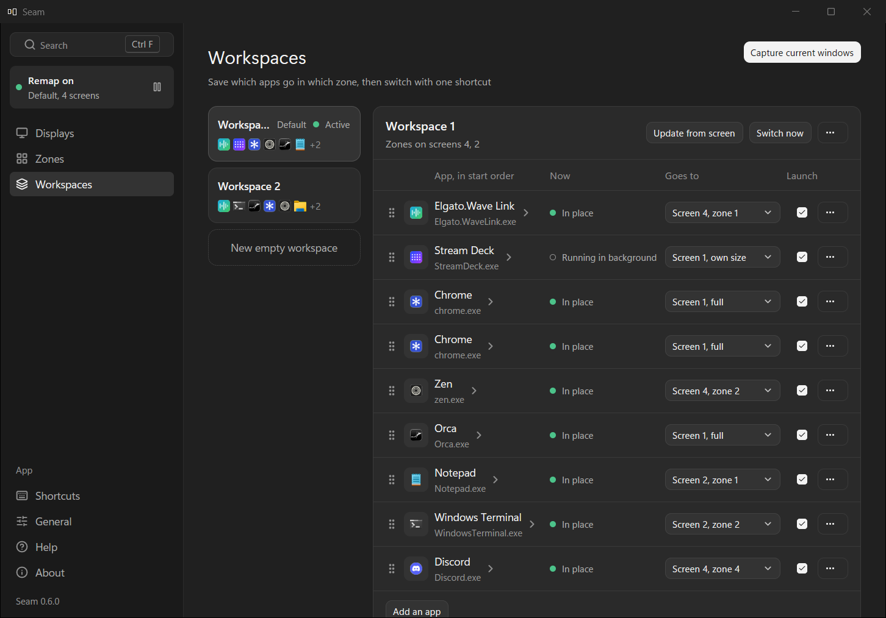
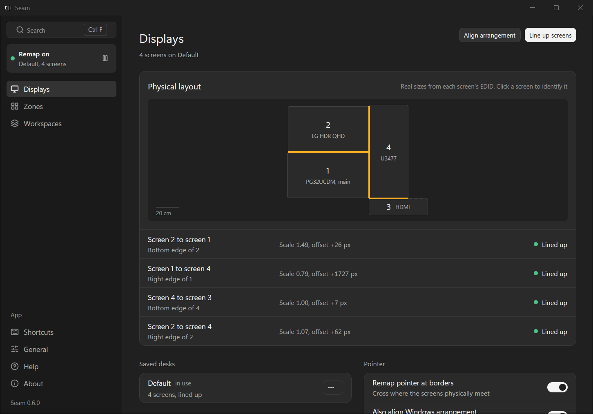
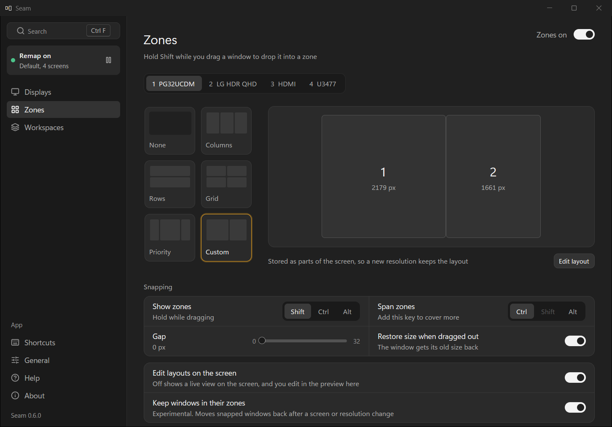
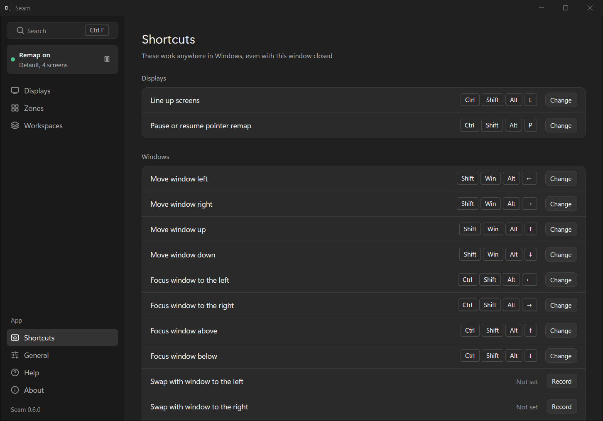
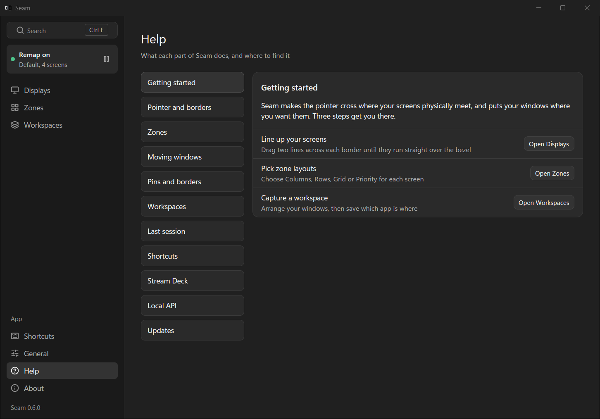

<div align="center">


# Seam

**Line up your screens on Windows 11, then put your windows where you want them.**

Seam makes the pointer cross exactly where your screens physically meet, snaps windows into zones, and saves your window layouts as workspaces you switch with one shortcut. It is a small tray app for Windows 11 on x64 and ARM64.

[](https://github.com/F3NN3X/seam/releases/latest)
[](https://github.com/F3NN3X/seam/actions/workflows/ci.yml)
[](LICENSE)
[](https://github.com/F3NN3X/seam/releases)


[Download](#getting-started) | [Features](#features) | [FAQ](#faq) | [API docs](docs/api.md) | [Changelog](CHANGELOG.md)



</div>

<details>
<summary><b>Table of contents</b></summary>

- [Features](#features)
  - [Pointer and borders](#pointer-and-borders)
  - [Zones](#zones)
  - [Window control](#window-control)
  - [Pins and borders](#pins-and-borders)
  - [Workspaces](#workspaces)
  - [Last session](#last-session)
  - [Shortcuts](#shortcuts)
  - [Tray menu](#tray-menu)
  - [Help](#help)
  - [Stream Deck](#stream-deck)
  - [Local API](#local-api)
- [Getting started](#getting-started)
  - [Install](#install)
  - [First run](#first-run)
  - [Stream Deck plugin](#stream-deck-plugin)
- [FAQ](#faq)
- [Shortcuts](#shortcuts-reference)
- [Troubleshooting](#troubleshooting)
- [How it works](#how-it-works)
- [Debug log](#debug-log)
- [Building from source](#building-from-source)
- [Limits](#limits)
- [License](#license)

</details>

## Features

### Pointer and borders

Windows arranges screens in **raw pixels**. When two screens have different pixel densities (a 27" 4K next to a 27" 1440p, a laptop under an external), no arrangement can be right along the whole edge. Windows keeps the same pixel row when the pointer crosses, so the pointer jumps. Seam fixes this with a small low-level mouse hook. Whenever the pointer crosses a border you've lined up, the hook puts it where the screens physically meet.



- **Line Up** opens a full-screen overlay on every screen, with big numbers so you know which screen is which. For each border you drag two lines until they run straight across the bezel. No measuring.
- The **Physical layout** card on Displays has two views. **Seam** is the map of your desk, with each border drawn by kind: a solid amber line when it's lined up, a dashed one when it's glued, and a muted dotted one with "Not on your desk" when Windows has the screens touching but your desk doesn't. **Windows** is the arrangement exactly as Windows has it, in pixels, with a note such as "18 px gap" where two screens face each other across a gap. Clicking a screen in either view flashes its number on it. **Show on screens** draws the chosen view on every real screen for a few seconds, with each screen's number and model and a band along each edge that has a neighbour. Esc, a click or 8 seconds closes it.
- **Glue** is for screens that touch on your desk but have a gap between them in Windows. Line Up offers each such pair after the touching borders, and G glues it. The pointer then crosses the gap where the screens physically meet, and rests at the edge until you push past it, 60 px unless you change **Glued edge push** on Displays, so an auto-hide taskbar there still shows. Past the end of a glue, the edge is a dead edge that Seam holds. A pair found from the screens' sizes starts glued, and a pair found only from the pixel layout starts off. Displays calls such a border "Glued to the right edge of 1".
- **Not on my desk** is for screens that touch in Windows but not on your desk. Press N in Line Up, or use **Not on my desk** (and **On my desk**, to undo it) in the border's **...** menu on Displays. The pointer stops at that edge both ways, or crosses to a glued screen past it, and Displays calls it "Not on your desk".
- Line Up's aids: each step names both screens with their model and says which way to move each line, a band of stripes shows whether the edge runs straight across, and **Type measurements in Line Up** (off by default, on Displays) adds a field to type the offset in cm. See [First run](#first-run).
- **Remap pointer at borders** pauses and resumes the hook, from the tray or with Ctrl+Shift+Alt+P.
- **Edge resistance** (off by default, on Displays) holds the pointer at the edge to another screen until you push that many pixels past it, so you can grab a window's edge or corner there. It works at every border, lined up or not, and where Ease cursor movement would carry the pointer from a dead edge to the screen beside it. It gives way while a mouse button is down, so dragging a window across is never slowed, and stays off while the remap is paused and during Line Up. Where a border is glued, the larger of it and **Glued edge push** applies.
- **Also align Windows arrangement** (on by default) moves your screens in the Windows arrangement so each border lines up at the middle of its physical overlap. Dragging a window between screens then looks right even with Seam closed. You can undo it anytime in Display settings.
- Each set of screens is a **desk**, with its own borders, zones and workspaces. **Saved desks** lists them, and each desk's menu has **Rename** and **Forget**. Dates show in your local time, as "Lined up today", "yesterday" or "3 days ago". Reconnect the same screens and the layout comes back.
- Seam relies on Windows' **Ease cursor movement between displays**, so the pointer can always leave a screen toward its neighbour. It warns you when that's off, and **Turn it on** (on the Displays page, or when the Seam window asks once) turns it on and checks that Windows kept it. Seam never turns it off.

### Zones

Pick a layout for each screen (Columns, Rows, Grid, Priority, Main + stack or Stack + main), hold **Shift** while you drag a window, and let go over a zone to snap it in. The zones show on the screen under the pointer, and the one under it turns amber.



- Hold **Ctrl** as well to cover several zones with one window.
- **Zones on** turns drag snapping on or off.
- **Tile this screen's windows** (a shortcut with no key until you set one, **Tile windows** in the tray menu, or `screen.tile` in the API) puts the loose windows on a screen into its zones at once. The focused window, or the one you used last, takes the biggest zone, and each of the others takes the nearest free one. A screen with no layout is given one for the number of windows: two columns, Main + stack, the 2x2 grid, then 3x2 and 3x3. It takes up to nine windows, keeps windows that are already in a zone where they are, and leaves alone pinned and sticky windows, minimized ones, and those of apps running as administrator. A notification offers **Undo** for 8 seconds, which puts each window back and takes away a layout the tile picked.
- Both keys, the **gap** between zones, and whether a window gets its old size back when you drop it outside a zone are on the Zones page.
- **Edit layout** makes your own layout: split a zone side by side or top and bottom, drag a divider (it snaps to quarters and thirds), merge two neighbours, then press **Done**. Esc throws the changes away and Ctrl+Z undoes the last one. A layout can have up to 128 zones.
- Your own layouts go into a library shared by every desk and screen, each with its own tile after the templates, named "Custom 1", "Custom 2" and so on. Click one to give it to the screen. Its **...** menu has **Edit**, **Rename**, **Duplicate** and **Delete**: editing one changes every screen that uses it, and deleting one leaves those screens with their zones. **New layout** starts one from a single zone. **Edit layout** on a template saves the result as a new library layout and never changes the template.
- **Save from windows** makes a library layout from where the windows on the screen are now, one zone each, and snaps them in. Windows that overlap, or can't be split by straight lines across the screen, don't line up into zones.
- Picking a layout tile puts the windows on that screen into the new zones, one window to a zone, and a notification offers **Undo** for 8 seconds. Snapped windows go first, each to the zone nearest where it was snapped, then the others to the free zone nearest them. Windows past the last zone stay where they are, and picking None moves nothing.
- A screen whose layout is none of these, after you drag a window's edge for example, shows **Changed**, with **Save as layout** to keep it in the library.
- The editor opens on the screen itself, over its work area. If you'd rather edit in the preview, turn off **Edit layouts on the screen**.
- Drag the edge of a window in a zone and the windows in the zones on the other side follow it live, with no gaps or overlaps. None goes below the smallest size its app allows: the next divider moves instead. When you let go, the window fits its zone and the screen's layout is saved as Changed. Esc puts everything back. Turn off **Resize neighbours with a window** to resize a window on its own.
- **Keep windows in their zones** (experimental, off by default) moves snapped windows back into their zones after a screen, resolution or scaling change, or after the PC wakes. Windows you've moved since they snapped are left alone.
- Layouts belong to the set of screens you have connected, so each desk keeps its own.

#### Where apps open

**Where apps open**, at the bottom of the Zones page, puts an app's window in a place whenever it opens, with or without a workspace. **Add an app**, pick its screen and a zone (or the full screen), and the next window of that app goes there once, a moment after it opens. **Put apps in place when they open** on Workspaces handles the workspace in use, and when that workspace has a row for an app, it owns every window of that app and the rule doesn't apply to it, whether or not that switch is on. Dialogs, apps that run as administrator and apps listed under **Left alone** are never moved, and a rule whose screen isn't connected does nothing. **Left alone** is the list of apps Seam never manages.

Windows 11 shows its own snap layouts when you drag a window to the top of the screen. Seam leaves that alone. To turn it off, go to **Settings > System > Multitasking** and switch off "Show snap layouts when I drag a window to the top of my screen".

### Window control

"Left" means left on your desk, as the screens physically stand, not in Windows' pixel layout. So left from the top of a tall screen beside two stacked ones goes to the upper one.

- **Shift+Win+Alt+arrows** move the focused window. A window in a zone goes to the next zone that way, and at the edge onto the nearest zone of the screen next to it. A window in no zone goes to the next screen, in the same place there.
- **Ctrl+Shift+Alt+arrows** focus the nearest window that way.
- **Swap** trades places with the nearest window that way, zones included. It has no key until you set one.
- **Focus on this window** minimizes the other windows on its screen, and pressing it again brings them back. Windows pinned on top or kept out of workspace switches stay. It has no key until you set one, and `window.focus_only` with `scope` `workspace` minimizes everything outside the workspace in use instead.
- **Spotlight** dims everything but the window you're using, on every screen. It has no key until you set one. With the desktop or taskbar in front the dim is hidden. It keeps working next to another window manager.
- **Grow window into its neighbour** and **Shrink window** move the divider beside a window in a zone by 5% of the screen, towards the bigger neighbour first and side to side before up and down. **Give window two thirds of its group** gives it about two thirds of the screen along the layout's main split, and a second press puts the zones back. The windows in the other zones follow, and none goes below the smallest size its app allows: a divider that would squeeze one pushes the next divider along instead. A changed layout is saved and shows as Custom. These have no key until you set one.
- **When a window moves to another screen**, in the Windows card on the Zones page, sets the size a window gets on a screen with no zones, whether Seam moved it by key, by another app, or a workspace put it back on a different screen than it was saved on:
  - **Let Windows scale it** (default) leaves it to Windows' scaling.
  - **Keep its pixel size** keeps the same width and height in pixels.
  - **Keep its real size** keeps the same size on the desk, from the sizes the screens report. A screen that doesn't report its size (some TVs and small panels) is scaled by Windows, and the page says which.
  - **Also when I drag a window to another screen** does the same after you drop a window on another screen with the mouse. It's off until you turn it on.
  - Zones, maximized and full screen windows always take the size of their place.
- Seam leaves alone windows from apps running as administrator, windows that aren't responding, and its own windows. When an administrator app's window won't move, a balloon names the app, once per app, and clicking it opens the Help topic "Apps running as administrator".
- Next and previous zone are still on the Shortcuts page and in the API. New installs give them no key, and an earlier `config.json` keeps the keys it has. Win+Alt+arrows aren't the move keys because some Windows builds hold them already.
- If komorebi, GlazeWM or LeopardWM is running, Seam notices within 30 seconds and leaves placing windows to it: drag snapping, the zone keys, move and swap, and keeping windows in their zones are off, and the Zones page says why. **Another window manager handles my windows** does the same for any other one. The pointer remap, Line Up, workspaces, focus keys and pins keep working.

### Pins and borders

- **Pin window on top** keeps the focused window above the others until you press it again.
- **Keep window out of workspace switches** makes the focused window sticky: a workspace switch never moves, minimizes or closes it, and capture leaves it out.
- **Focus border**, on the Zones page, colours the border of the window that has focus in your Windows accent colour. It's off until you turn it on, needs Windows 11, and skips windows from apps running as administrator.
- **Pin border**: a window pinned on top or sticky gets a Seam amber border, which wins over the focus border until you unpin it. Both colours are picked from swatches under the Windows card on the Zones page: Windows accent, Seam amber, blue, teal, green, red, pink or white. **None** leaves that border to the app and Windows, and **Custom colour** opens a colour picker with a palette, sliders and a hex field.
- **Release pinned windows**, in the tray menu, takes back every pin and border Seam set. Seam does the same when you quit. An update or a restart that you didn't ask for keeps the pins: the next start keeps the pins it finds and resets the borders.
- **Tell me when a pinned window closes** is off until you turn it on. Seam can't stop an app closing, so it tells you afterwards: "Notepad was pinned and has closed. Click to reopen". A click starts the app again and pins its first new window within 15 seconds. Release all, quitting Seam and a workspace's **Close** don't count.
- **Pinned windows stay when I switch workspaces**, on the Zones page, makes a switch leave a window pinned on top alone, like a sticky one, though capture still saves it. It's off until you turn it on.

The three pin keys have no key until you set one on the Shortcuts page.

### Workspaces

A workspace saves which app is on which screen and in which zone (or at its own size), whether it's minimized, maximized or full screen, which window is in front of which, and which had the focus, for the desk you have connected.


- **Capture current windows** saves the windows open now. Only app windows with a taskbar button are saved, so overlays, helper windows, apps closed to the tray, and the apps the zones leave alone aren't. **New empty workspace**, under the list, makes one with no apps, ready for **Add an app**.
- **Switch now**, the workspace's shortcut, or **Workspaces** in the tray menu puts each app back the same way. A minimized window stays minimized and restores into its zone later, and windows already in place aren't touched.
- **Start missing apps** starts the apps that are ticked under Launch and aren't running, and waits up to 15 seconds for each window.
- **Other windows** says what a switch does with everything else on the desk's screens: leave it, minimize it, or close it. Close only asks. Each app gets a normal close request, so one with unsaved work shows its own prompt and stays open. Seam never ends a process.
- **Update from screen** saves the windows as they are now into a workspace, and keeps each app's launch details, its place in the order, and the apps that aren't running.
- **Save windows to the active workspace** (no key until you set one) does the same for the workspace in use without opening Seam, and says "Saved Coding". Click that notification within 8 seconds to undo it. With no workspace in use it saves a new one, "Workspace 3" say, and that becomes the one in use.
- **Switch back to the previous workspace** (no key until you set one) goes to the workspace that was in use before this one, and pressing it again goes back. The tray's **Workspaces** menu starts with "Switch back to <name>" when there is one, and Stream Deck has a Switch back key. With nothing to go back to it says "No workspace to switch back to".
- **Open alongside**, on a workspace's **...** menu, switches once and leaves the other windows alone, whatever **Other windows** says. The setting itself doesn't change.
- **Set as default**, on a workspace's menu, makes it the one in use when Seam starts and none is remembered.
- The list shows each workspace's apps as a row of icons, up to six and then "+n". The one in use shows a green dot and "Active", or "Active, moved" once one of its windows moved.

**The editor.** The workspace's table is an editor, and each change saves at once with Undo.

- Pick where an app goes, including **Where it is now**, and how it shows: normal, minimized, maximized or full screen.
- The rows are the start order. Drag one by its grip, or press Alt+Up and Alt+Down on it.
- Click an app's name for its launch details: a delay of up to 30 seconds, and **Wait for this app's window before opening the next**, which shows as a "then wait" line. Apps that are already running are put in place first, and each started app as soon as its window shows.
- **Add an app** picks one from the windows open now or from the Start menu's apps.
- The **...** on a row removes the app, or with **Never include this app** also keeps it out of every capture and of the zones. **Left alone** on the Zones page lists those apps.

**Live status.** While the page is open, the **Now** column shows how each app is doing: in place, moved, minimized, not running (with "Will open" when the switch would start it), running in the background (apps that close to the tray), or can't be moved because it runs as administrator. When something moved or was minimized, **Put windows back** puts it back. That's Snap back, which also has a shortcut, **Snap back to this workspace**, and a Stream Deck key.

**Put apps in place when they open**, at the bottom of the page, is off until you turn it on. Then an app of the workspace in use that you open by hand goes to its place once, a moment after its window shows. A second window of it, an app the workspace doesn't have, and a window you drag away are left alone.

**Export and import.** Each workspace's **...** menu has **Export...** and **Import...**. An imported workspace starts with launching off, and every app has to be ticked again, because a file from someone else shouldn't be able to start programs for you. Windows are mapped to your screens by device path, then by number and model, then by number, and any that match nothing stay where they are.

### Last session

**Offer to restore my windows after I sign in**, on General, is off until you turn it on. Seam then keeps a hidden last session for each desk: which apps are where, and which are pinned. It saves it 30 seconds after it last snapped, pinned or switched, and again when you sign out or shut down.

When Seam starts at sign-in, it asks "Restore your last session? Click to restore". A click works like a workspace switch that leaves other windows alone: windows go back to their zones, and pins come back. Nothing starts without the click.

**Who reopens the apps** picks between Windows' Restart apps (Seam starts nothing and puts each window back as it appears, for up to a minute) and Seam (it starts the missing apps, and turns Windows' Restart apps off until you switch back or turn restore off).

### Shortcuts



Shortcuts work anywhere in Windows, even with the Seam window closed. Each has its own row on the Shortcuts page, and each workspace can have one too. If another app already holds a combination, its keys turn red and Seam keeps running without it. The table is under [Shortcuts](#shortcuts-reference).

### Tray menu

- A greyed line at the top says how many screens there are and how many borders are lined up.
- **Open Seam...** opens the Seam window, which holds the other settings.
- **Line Up Screens...** calibrates.
- **Workspaces** switches to a workspace on this desk. It's only shown when the desk has some.
- **Remap pointer at borders** pauses or resumes the hook.
- **Release pinned windows** takes back every pin and focus border Seam set.
- **Quit Seam** closes Seam.

Left-clicking the icon opens Seam on a new install. If you're upgrading from v0.1 it keeps opening Line Up. **Left-click** under Tray icon on General sets which. Running `seam.exe` again while it's already running opens the Seam window, and `seam.exe --line-up` opens Line Up, or starts with it open. The Seam window opens centred on the screen the pointer is on. `seam-settings.exe --page help` opens it on a page (`displays`, `zones`, `workspaces`, `shortcuts`, `general`, `help` or `about`), and switches a window that is already open to it.

### Help

**Help**, at the bottom of the Seam window's sidebar, explains each part of Seam in a short topic, starting with Getting started, and including glue, Not on my desk, the Line Up aids and the two layout views. Each topic has a button to the page it's about, and Search (Ctrl+F) finds the topics too.



### Stream Deck

A Stream Deck plugin in `integrations/streamdeck` puts Seam on keys. It talks to the running Seam over the local API, so **Let other apps control Seam** has to stay on in General.

| Action | What it does |
|---|---|
| Switch workspace | Pick a workspace on the current desk. The key lights while it's in use, with an amber dot once a window of it was moved or minimized. Pressing it puts them back. |
| Snap back | Puts the windows of the workspace in use back. |
| Switch back | Switches to the workspace that was in use before this one. |
| Save windows | Saves the windows into the workspace in use, as **Save windows to the active workspace** does. |
| Tile screen | Puts the loose windows on the screen under the pointer into its zones. |
| Line up screens | Opens Line Up. |
| Pause or resume remap, Zones on or off | Two-state keys that follow Seam, so they stay right when you change a setting elsewhere. |
| Next zone, Previous zone | Move the focused window. |
| Move window, Focus window | Pick a direction in the key's settings. They work as the shortcuts do. |
| Pin on top | Pins the focused window on top, or unpins it. |
| Release pinned windows | Takes back every pin and focus border Seam set. |
| Desk | Shows the active desk's name. Pressing it opens the Displays page. |

When Seam isn't running, every key says so and reconnects by itself once it is. The plugin can't check that the program answering on Seam's connection is really Seam, which Seam's own apps do. It only sends commands like "switch workspace" and reads status, so on a PC shared with other Windows accounts the most another account could do is see that status or ignore the keys. The [API docs](docs/api.md#security-model) explain.

### Local API

Other programs on the PC can read Seam's status, switch workspaces, line up screens and move windows through a local, per-user named pipe, with no network. That is how the Stream Deck plugin works. **Let other apps control Seam** on General turns it on or off. The [API docs](docs/api.md) cover every method, event and error, with client examples in PowerShell, Node and Python.

## Getting started

### Install

| | Download | Notes |
|---|---|---|
| **Installer** (recommended) | `Seam-Setup-X.Y.Z.exe` from [Releases](https://github.com/F3NN3X/seam/releases) | For you only, no admin prompt. Adds Seam to the Start menu and to Installed apps. |
| **Portable zip** | `seam-X.Y.Z-windows-x64.zip` from the same page | Unzip it and keep both exes together. |
| **Microsoft Store** | Once it's live | The Store updates it, and winget finds it through the `msstore` source. |

Each comes in two builds. **x64** is for most PCs. **ARM64** (`Seam-Setup-X.Y.Z-arm64.exe`, `seam-X.Y.Z-windows-arm64.zip`) is for PCs with an ARM processor, such as Snapdragon laptops. The x64 build runs on those too, emulated. Both installers use the same folder, so running the other one's setup switches your install over, and the updater keeps each build on its own architecture.

The installer and the zip are unsigned, so Windows SmartScreen warns about an unknown publisher the first time. Choose **More info**, then **Run anyway**. See [Troubleshooting](#troubleshooting). To update the zip by hand, download the new zip, quit Seam, and replace both exes.

Seam has a built-in updater that only installs releases signed with Seam's key. It checks once a day, and About shows the result of each check.

### First run

1. In **Settings > System > Display > Multiple displays**, turn on **Ease cursor movement between displays**. Seam relies on it, and its Displays page has **Turn it on** while it's off.
2. Run `seam.exe`. It lives in the tray, and opens the Seam window when you start it yourself. At sign-in it starts in the tray only. On a new set of screens it asks once, unless you turn off **Offer to line up new screens** on General.
3. **Line up your screens.** Choose **Line Up Screens...** in the tray menu, or press Ctrl+Shift+Alt+L. For each border, the reference screen shows two coloured lines. On the neighbouring screen, drag the matching lines until each one runs straight across the bezel:
   - **Grab a line** to move just that line. This sets the scale.
   - **Drag anywhere else** to move both lines. This sets the height.
   - Arrow keys nudge the selected line (Shift moves 10 px, Ctrl moves both). Tab switches lines. R resets to the guess from your screens' EDID.
   - The pointer already follows your lines while you adjust, so move it across the border to check.
   - **G** glues a pair that touches on your desk but has a gap in Windows. Line Up asks about each such pair after the touching borders. Pairs whose sizes put them side by side start glued, and the rest start off and are skipped unless you press G. Glued screens get the same two lines, and you line them up as they stand on your desk.
   - **N** marks two screens that touch in Windows but not on your desk. The lines dim, and Seam stops the pointer at that border instead of letting it cross. Press N again to undo it.
   - Each step names both screens with their model, such as "Line up screen 3 (HDMI) with screen 4 (U3477)", and says which way to move each line, such as "straight below" or "level with".
   - A band of faint diagonal stripes runs along the shared edge on both screens, 10 mm apart on the desk. If they run on straight across the edge, the screens are lined up. If they step, the offset is off, and if the spacing changes, the scale is off. Screens that report no size get no stripes.
   - **M** types the offset instead of dragging, when **Type measurements in Line Up** is on in the Pointer card on Displays. It asks how many cm screen B's top (or left) edge sits below (or to the right of) screen A's, and moves the lines to match. Tab flips below and above, Enter applies and Esc closes the field. It needs both screens to report their size.
   - **Enter** goes to the next border, or finishes after the last one. **Backspace** goes back, **Esc** cancels.
4. **Pick zone layouts.** Open **Zones**, pick a layout for each screen, and hold Shift while you drag a window.
5. **Capture a workspace.** Arrange your windows, open **Workspaces**, and press **Capture current windows**. Give it a shortcut on the Shortcuts page.

When you finish Line Up, Seam saves the layout for that exact set of screens and turns on the remap. The **Help** page in the Seam window repeats these steps, with a button to each page.

### Stream Deck plugin

Download `co.f3nn3x.seam.streamDeckPlugin` from the release page and open it. The Stream Deck app installs it and adds a Seam group to the action list. To build it yourself, run `pnpm install`, `pnpm build` and `pnpm run pack` in `integrations/streamdeck`. The packed file lands in its `dist` folder.

## FAQ

**Why does the pointer jump when I move between screens of different sizes?**
Windows lines screens up in raw pixels and keeps the same pixel row when the pointer crosses. With different pixel densities no arrangement can be right along the whole edge, so the pointer lands somewhere other than where the screens meet. Seam's Line Up learns where they physically meet, and its mouse hook moves the pointer there as it crosses.

**Why must "Ease cursor movement between displays" be on?**
Without it, Windows blocks the pointer from leaving a screen at a point that has no neighbouring pixels. With different sizes, much of a screen's edge is like that, so the pointer would never get to the border where Seam can carry it across. Seam warns you on the Displays page when it's off. **Turn it on** does it for you. Seam never turns it off, so turn it off in Display settings if you want it off.

**My screens touch on the desk, but Windows has a gap between them. Can the pointer cross it?**
Yes, if you glue them in Line Up (G). When the pointer goes past the edge into the gap, Seam carries it to where the other screen physically continues, after a push of 60 px, or what you set in **Glued edge push**. If Windows has another screen under the pointer there, that screen wins. Align arrangement keeps the gap, and refuses a move that would break a glue.

**Windows has two screens touching that don't on my desk**
Press N on that border in Line Up, or choose **Not on my desk** in the border's **...** menu on Displays. Seam stops the pointer there, both ways, as if Windows had a gap. If you've glued another screen past that edge, the pointer goes there instead, after the same push as any glued edge. Align arrangement never moves a screen to match that border.

**Why can't Seam move some windows?**
Windows doesn't let a normal app move the windows of an app running as administrator. Seam skips them in zones, window control and workspaces, tells you once when that happens, and shows "can't be moved" in the workspace editor. Run the app without administrator rights if you can.

**Microsoft Store build or GitHub build?**
They behave the same, apart from how they update and install. The Store build is updated by the Microsoft Store, has no built-in updater, and removes its settings when you uninstall it. The GitHub build (installer or portable zip) is unsigned, so SmartScreen warns the first time, and it has Seam's own updater. Both come in x64 and ARM64.

**How are updates verified?**
The updater, which runs in `seam-settings.exe` and never in the tray, downloads a `latest.json` manifest from Seam's GitHub releases and checks its minisign signature against the public key built into Seam. It only follows download links on Seam's own releases, and checks each file's size and SHA-256 against the manifest before it installs. A release that fails any of these checks isn't installed, and About says why.

**Where do the config and the log live?**
In `%APPDATA%\Seam`: `config.json` holds your settings, desks, layouts and workspaces, and `seam.log` is the debug log, which exists only if you turn logging on (see [Debug log](#debug-log)). The updater keeps what it found in `%LOCALAPPDATA%\Seam\updates`. The Store build's settings are kept in its own package folder, because Windows redirects its writes. **Open**, on General, shows the folder. **Export...** saves your settings to a file, and **Import...** replaces them with one, after asking, and keeps a copy of the current ones in the settings folder.

**What happens to apps that close to the tray, like Stream Deck, Spotify, Discord or Steam?**
They have no window to save, so a capture leaves them out. If one is in a workspace, the editor shows "Running in background" instead of "Not running", and it doesn't count as moved. A switch reports it as running in the background rather than missing.

**Does Seam replace PowerToys FancyZones or komorebi?**
It overlaps with them, and it's built to coexist. Seam's zones work like FancyZones for drag snapping, and its workspaces restore your windows, but its main job is the pointer crossing between screens of different sizes, which neither does. It is not a tiling window manager like komorebi. If komorebi, GlazeWM or LeopardWM is running, Seam notices and leaves placing windows to it, and keeps the pointer remap, Line Up, workspaces, focus keys and pins working. If you run FancyZones too, give the Shift key to only one of them.

**Does Seam use the network?**
No, with one exception: the update check, which asks GitHub for the latest release (`api.github.com`, and downloads from `github.com`). It runs about once a day, and you can turn it off. The Store build leaves updating to the Store. The tray never touches the network, and the local API is a per-user pipe on your PC.

**How do I uninstall it?**
Use **Settings > Apps > Installed apps**. The installer's uninstaller asks whether to remove your settings. Uninstalling the Store version removes them. For the portable zip, turn off **Start with Windows** on General, quit Seam, delete the two exes, and delete `%APPDATA%\Seam` if you want your settings gone. The screen arrangement Seam aligned stays as it is, and you can change it in Display settings.

**Will Seam open my apps for me when I sign in?**
Only if you ask. Turn on **Offer to restore my windows after I sign in** on General. Seam then asks once at sign-in, and nothing starts without your click. See [Last session](#last-session).

**Can I script Seam or use it from another tool?**
Yes, through the [local API](docs/api.md), which is what the Stream Deck plugin uses.

## Shortcuts reference

| Keys | What it does |
|---|---|
| Ctrl+Shift+Alt+L | Line Up |
| Ctrl+Shift+Alt+P | Pause or resume the remap |
| Shift+Win+Alt+arrows | Move the focused window that way on the desk |
| Ctrl+Shift+Alt+arrows | Focus the window that way |
| Shift (while dragging) | Show the zones. Add Ctrl to cover several zones |
| None until you set one | Swap, grow, shrink, two thirds, tile, next and previous zone, the three pin keys, one capture key, **Snap back to this workspace**, **Switch back to the previous workspace**, **Save windows to the active workspace**, **Focus on this window**, **Spotlight**, and one key per workspace |

Set these on the Shortcuts page. Ctrl+Shift+Alt plus a number is a good choice for workspaces, since Ctrl+Alt alone types characters on many keyboards.

## Troubleshooting

- **"Windows protected your PC".** The GitHub build isn't signed, so SmartScreen warns about it. Choose **More info**, then **Run anyway**.
- **Smart App Control blocks it.** Smart App Control can refuse unsigned apps outright, with no way to run them.
- **The zip won't run.** Windows marks a downloaded zip as untrusted. Unblock it before unzipping: right-click it, choose **Properties**, tick **Unblock**. Or run `Unblock-File seam-X.Y.Z-windows-x64.zip` in PowerShell.
- **A shortcut doesn't work.** NVIDIA, AMD and Intel overlays hold some combinations. Shortcuts shows a conflict in red. Choose another one there.
- **The pointer still jumps.** Check that Ease cursor movement is on, that the remap isn't paused, and that Displays shows the border as lined up. Run Line Up again if you moved a screen.
- **The pointer jumps to the wrong screen at a gap.** Windows has the screens touching or apart differently from your desk. Glue the pair in Line Up if they touch on your desk with a gap in Windows, or mark the border **Not on my desk** if they touch in Windows but not on your desk.
- **No update arrives.** About says why when a check fails. The most common cause is a network that blocks `api.github.com`. Check by hand with **Check now**.
- **Something else.** Turn on the [debug log](#debug-log), reproduce it, and look in `seam.log`.

## How it works

For each shared border, Seam stores a linear map between the two edges, relative to each screen's own origin:

```
b = s * a + o
```

`s` is the physical scale (pixels on B per pixel on A), and `o` is the offset. Two line pairs lined up by eye solve both, so you never measure anything. Because the map is relative to each screen, it survives rearranging screens in Windows. Screens are identified by their device path, so layouts survive reboots and come back when you reconnect the same screens (home desk, office desk, and so on).

The hook runs on its own high-priority thread, so UI work can never delay mouse input. It only acts when the pointer leaves a screen across a calibrated border, and only if a physical screen is on the other side. Everywhere else it leaves Windows' behaviour untouched. It also stays out of the way when:

- An app or game confines the pointer (`ClipCursor`).
- Input is injected (remote desktop, automation tools).
- The screens no longer touch on the same side as when you calibrated, or for glued screens, no longer face each other on that side.

## Debug log

Turn on **Debug log** on General, run `seam.exe --log`, or set `SEAM_LOG=1`, to append to `%APPDATA%\Seam\seam.log`: monitors, resolved borders, every remap with its time in the hook, a once-a-minute line timing all hook events (with histograms of Seam's own time and of other apps' hooks, and counts over 1 ms), hook install and removal, display changes, and arrangement results. Quit any running Seam first, because a second launch only opens the window of the first one. Logging is off by default, and then adds only an atomic load to the hook.

## Building from source

On Windows with Rust installed:

```
cargo build --release
```

This builds the tray app, `target\release\seam.exe`. To include the settings panel, run `cargo build --release --workspace`, which also needs CMake and the Visual Studio C++ tools. Keep `seam-settings.exe` next to `seam.exe`.

- To build the Store package, see [`packaging/README.md`](packaging/README.md).
- To cross-compile from Linux, use `./build-cross.sh`. It needs `mingw-w64` and Rust's library sources for `-Zbuild-std`.
- `cargo test` runs the geometry and config tests on any OS.

## Limits

- Borders are found from the Windows arrangement. Screens with a gap between them there can be glued, but only when Windows has them the same way round as your desk, and Line Up only offers pairs whose edges face each other across up to 400 px with no other screen in between. A screen that faces nothing stays unreachable, as it is in Windows.
- Rotated screens work as long as Windows reports their rotated size, which it does. Mirrored screens have nothing to line up.
- "Align Windows arrangement" refuses layouts where moving one screen would break another border (some 2x2 grids). The pointer remap still works in those layouts.
- Windows of apps running as administrator are skipped by workspaces and zones, because Windows doesn't let Seam move them.
- Apps that restore their own positions when they start may move after Seam places them. Seam places a window once and doesn't fight the app.
- Workspaces don't restore browser tabs or open documents.
- Close only asks. Apps with unsaved work will prompt, and those windows stay open.
- The tray icon is drawn at runtime.

## License

[MIT](LICENSE).
