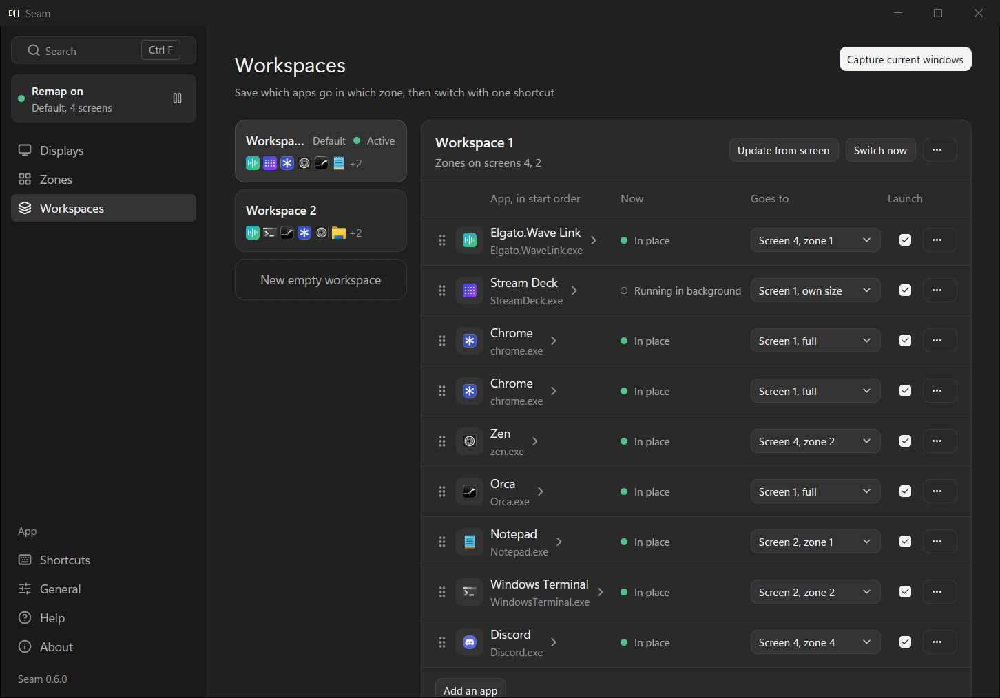
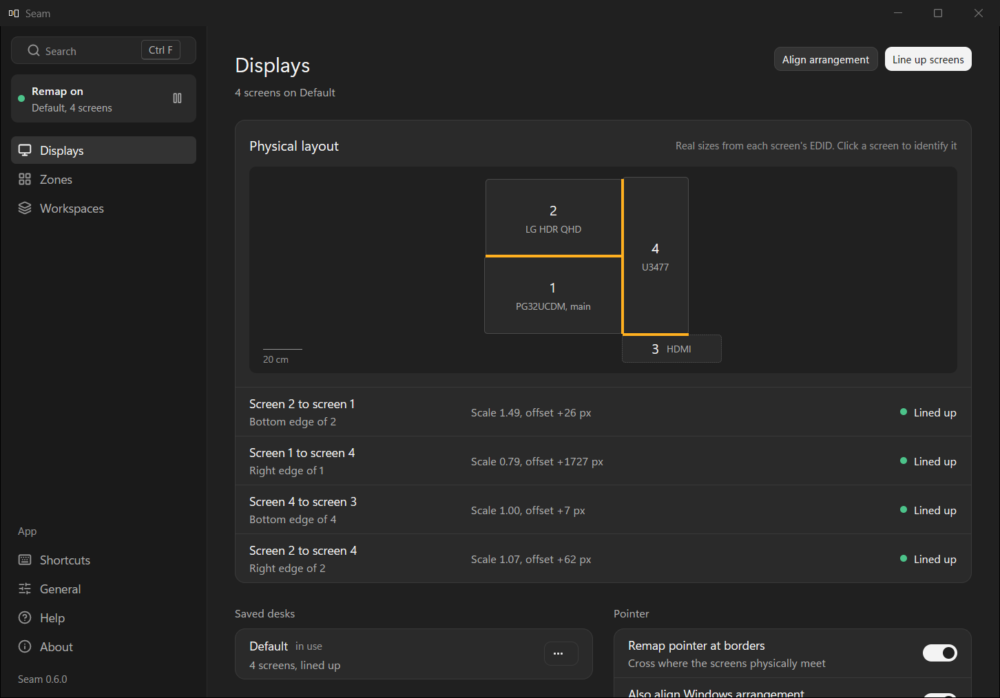
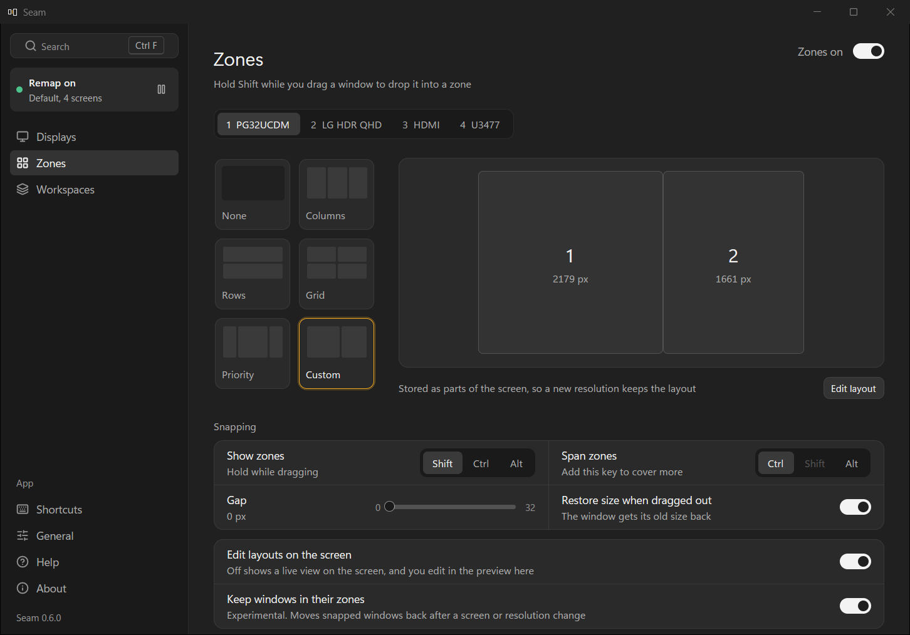
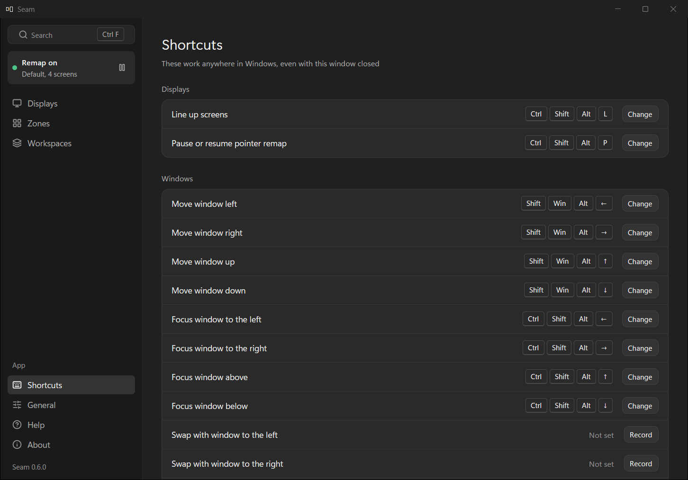
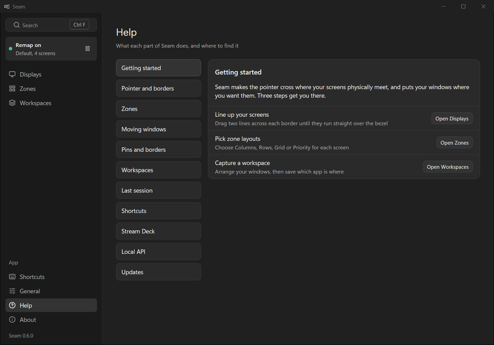

<div align="center">


# Seam

**Line up your screens on Windows 11, then put your windows where you want them.**

Seam makes the pointer cross exactly where your screens physically meet, snaps windows into zones and stacks, can tile new windows for you, shows every window at once in an overview, and saves your window layouts as workspaces you switch with one shortcut. A Seam window with a command bar holds the settings, a short first-run setup walks you through the first steps, and the tray icon shows at a glance whether Seam is on, paused or needs you. It is a small tray app for Windows 11 on x64 and ARM64.

[](https://github.com/F3NN3X/seam/releases/latest)
[](https://github.com/F3NN3X/seam/actions/workflows/ci.yml)
[](LICENSE)
[](https://github.com/F3NN3X/seam/releases)


[Download](#getting-started) | [Features](#features) | [FAQ](#faq) | [API docs](docs/api.md) | [Changelog](CHANGELOG.md)



</div>

<details>
<summary><b>Table of contents</b></summary>

- [Features](#features)
  - [Pointer and borders](#pointer-and-borders)
  - [Zones](#zones)
  - [Stacks](#stacks)
  - [Smart tiling](#smart-tiling)
  - [Overview](#overview)
  - [Window control](#window-control)
  - [Pins and borders](#pins-and-borders)
  - [Workspaces](#workspaces)
  - [When you sign in](#when-you-sign-in)
  - [The Seam window](#the-seam-window)
  - [Shortcuts](#shortcuts)
  - [Tray menu](#tray-menu)
  - [Help](#help)
  - [Accessibility](#accessibility)
  - [Stream Deck](#stream-deck)
  - [Local API](#local-api)
  - [Assistants (MCP)](#assistants-mcp)
- [Getting started](#getting-started)
  - [Install](#install)
  - [First run](#first-run)
  - [Stream Deck plugin](#stream-deck-plugin)
- [FAQ](#faq)
- [Shortcuts](#shortcuts-reference)
- [Troubleshooting](#troubleshooting)
- [How it works](#how-it-works)
- [Debug log](#debug-log)
- [Building from source](#building-from-source)
- [Limits](#limits)
- [License](#license)

</details>

## Features

### Pointer and borders

Windows arranges screens in **raw pixels**. When two screens have different pixel densities (a 27" 4K next to a 27" 1440p, a laptop under an external), no arrangement can be right along the whole edge. Windows keeps the same pixel row when the pointer crosses, so the pointer jumps. Seam fixes this with a small low-level mouse hook. Whenever the pointer crosses a border you've lined up, the hook puts it where the screens physically meet.



- **Line Up** opens a full-screen overlay on every screen, with big numbers so you know which screen is which. For each border you drag two lines until they run straight across the bezel. No measuring.
- The **Physical layout** card on Displays has two views. **Seam** is the map of your desk, with each border drawn by kind: a solid amber line when it's lined up, a dashed one when it's glued, and a muted dotted one with "Not on your desk" when Windows has the screens touching but your desk doesn't. **Windows** is the arrangement exactly as Windows has it, in pixels, with a note such as "18 px gap" where two screens face each other across a gap. Clicking a screen in either view flashes its number on it, and clicking a border selects it, with its details and actions under the map. The borders sit in one summary line that opens by itself when one needs lining up, and a legend sits under the map. **Show on screens** draws the chosen view on every real screen for a few seconds, with each screen's number and model and a band along each edge that has a neighbour. Esc, a click or 8 seconds closes it.
- **Glue** is for screens that touch on your desk but have a gap between them in Windows. Line Up offers each such pair after the touching borders, and G glues it. The pointer then crosses the gap where the screens physically meet, and rests at the edge until you push past it, 60 px unless you change **Glued edge push** on Displays, so an auto-hide taskbar there still shows. Past the end of a glue, the edge is a dead edge that Seam holds. A pair found from the screens' sizes starts glued, and a pair found only from the pixel layout starts off. Displays calls such a border "Glued to the right edge of 1".
- **Not on my desk** is for screens that touch in Windows but not on your desk. Press N in Line Up, or use **Not on my desk** (and **On my desk**, to undo it) in the border's **...** menu on Displays. The pointer stops at that edge both ways, or crosses to a glued screen past it, and Displays calls it "Not on your desk".
- **Inactive screens.** A screen that is plugged in but turned off in Windows (**Disconnect this display** in Display settings) shows on Displays, under the map, as a row with a grey dot and "Inactive", its model name, and **Open Display settings**. Seam can't use it and never turns it on, and the desk, its borders and its workspaces don't change. `state.get` lists it as `screens_inactive`.
- Line Up's aids: each step names both screens with their model and says which way to move each line, a band of stripes shows whether the edge runs straight across, and **Type measurements in Line Up** (off by default, on Displays) adds a field to type the offset in cm. See [First run](#first-run).
- **Remap pointer at borders** pauses and resumes the hook, from the tray or with Ctrl+Shift+Alt+P.
- **A new screen.** When you connect a set of screens Seam hasn't seen and would offer to line up, Displays says "A screen Seam hasn't seen is connected" with **Line up the new screen**, the sidebar reads "New screen to line up", and the tray icon gets a red dot. The note, the sidebar and the dot go once Seam's balloon about it has shown, and with **Offer to line up new screens** off on General they don't appear.
- **Edge resistance** (off by default, on Displays) holds the pointer at the edge to another screen until you push that many pixels past it, so you can grab a window's edge or corner there. It works at every border, lined up or not, and where Ease cursor movement would carry the pointer from a dead edge to the screen beside it. It gives way while a mouse button is down, so dragging a window across is never slowed, and stays off while the remap is paused and during Line Up. Where a border is glued, the larger of it and **Glued edge push** applies.
- **Also align Windows arrangement** (on by default) moves your screens in the Windows arrangement so each border lines up at the middle of its physical overlap. Dragging a window between screens then looks right even with Seam closed. You can undo it anytime in Display settings.
- Each set of screens is a **desk**, with its own borders, zones and workspaces. **Saved desks** lists them, and each desk's menu has **Rename** and **Forget**. Dates follow your Windows region, as "Lined up today", "yesterday" or "3 days ago", and as a day and month for older ones. The **desk menu** under the page title lists the saved desks, with **Rename this desk** and **Forget desks not seen in 30 days**, which names the desks it will remove and offers Undo. Reconnect the same screens and the layout comes back.
- Seam relies on Windows' **Ease cursor movement between displays**, so the pointer can always leave a screen toward its neighbour. It warns you when that's off, and **Turn it on** (on the Displays page, or when the Seam window asks once) turns it on and checks that Windows kept it. Seam never turns it off.

### Zones

Pick a layout for each screen (Columns, Rows, Grid, Priority, Main + stack or Stack + main), hold **Shift** while you drag a window, and let go over a zone to snap it in. The zones show on the screen under the pointer, and the one under it turns amber.



- Hold **Ctrl** as well to cover several zones with one window.
- Hold **Ctrl** as you let go of a snapped window outside the zones to take it out of the layout: its zone goes, the others close the gap, and Undo is offered for 8 seconds. Without Ctrl the gap stays.
- **Zones on** turns drag snapping on or off.
- **Tile this screen's windows** (a shortcut with no key until you set one, **Tile windows** in the tray menu, or `screen.tile` in the API) puts the loose windows on a screen into its zones at once. The focused window, or the one you used last, takes the biggest zone, and each of the others takes the nearest free one. A screen with no layout is given one for the number of windows: two columns, Main + stack, the 2x2 grid, then 3x2 and 3x3. It takes up to nine windows, keeps windows that are already in a zone where they are, and leaves alone pinned and sticky windows, minimized ones, and those of apps running as administrator. A notification offers **Undo** for 8 seconds, which puts each window back and takes away a layout the tile picked.
- **Rotate windows** (a shortcut with no key until you set one, or `screen.rotate` in the API) moves every window snapped on the screen under the pointer to the next zone, and the last to the first. The same key with Shift added goes the other way. A stack moves as one, and a tiled screen rotates its tiles. Windows that float, pinned and sticky windows, minimized windows and administrator windows stay where they are. **Reset sizes** (`screen.reset_sizes`) puts a screen whose layout shows **Changed** back to the layout it came from, with its windows, or evens out a tiled screen's splits. Both offer Undo for 8 seconds.
- **Quick layout** (a shortcut with no key until you set one, or `zones.quick` in the API) opens a small panel on the screen under the pointer with its layouts as numbered thumbnails: the built-in ones, the custom layouts for that screen, then None. Press 1 to 9, or the arrows and Enter, to pick one as clicking its tile on the Zones page does. **Ctrl+Z** undoes the last pick made there, **Esc** or a click outside closes it, and the panel stays open after a pick so you can try another.
- Both keys, the **gap** between zones, and whether a window gets its old size back when you drop it outside a zone are on the Zones page, under **Snapping**. The rarer options sit behind **More snapping options**, and **Reset to default** on the section puts the snapping options back, with Undo, and leaves screen margins alone. **Pause** is one of the choices for the snapping key, next to the keys, and a config that already has both a key and **Pause to snap** keeps both, which the row says.
- **Screen margins** (next to the gap, for the screen you chose, in a popover with four sliders) keep room free along the top, right, bottom and left of a screen, in pixels at 100% scale, up to a quarter of the screen on each side. Zones, Tile windows, Fit group, Quick layout picks (its thumbnails stay schematic), smart tiling, windows snapped beside each other and the overview's drop targets (a window dropped on a screen with no zones is centred inside them) stay inside what is left, so a screen can keep a strip clear for a bar or an ultrawide's middle. Maximized and full-screen windows, Line Up and the places a workspace saves don't change. Each screen on each desk has its own.
- **Swap with the window already in a zone** (on by default) makes a window you drop on a zone another snapped window holds trade places with it: that window takes the dropped window's old zone, or its old spot if it was loose. Turn it off and they overlap as before. A window that runs as administrator or isn't responding stops the swap.
- While zones show, the lit zone is exactly where the window lands, and grey outlines show where any window it pushes aside goes. Until you let go, **scroll the mouse wheel** to step through the whole zone, 1/2, 1/3, 2/3, the zone with its neighbour, and the whole screen; it stops at either end. A share sits on the side of the zone nearest the pointer and follows it. **Right-click** drops the window where you let go, without a zone. The keys do the same: **Tab** steps through the zone, the zone with its neighbour on the side the pointer leans to, and the whole screen (**Shift+Tab** goes back, unless Shift is your show key; with Alt held, Tab is Windows' Alt+Tab). **1**, **2** and **3** give the window a half, a third or two thirds of that span and **0** all of it, with the **arrows** picking the side. A part splits the zone in two: the rest becomes a zone, a window that held it moves there, the layout is saved as Custom, and a notification offers **Undo** for 8 seconds. With several windows there, it swaps as usual instead. **Esc** drops the window where you let go, without a zone. Other keys, clicks and moves reach your apps, and the wheel, the right button and those keys are only Seam's while zones show.
- **Snap beside a window** (on by default): while zones show, point at the edge of another window and the drop puts the two side by side, the dragged window taking half of that window's place on that side and the other window the rest. The wheel, or **1**, **2** and **3**, make the share 1/2, 1/3 or 2/3. On a screen with zones it splits the zone that window holds (or the zone under the pointer), the layout is saved as Custom, and a notification offers **Undo** for 8 seconds. On a screen with no zones the two become a group, kept until Seam restarts: dragging the edge between them resizes both, the gap has a handle, and a third window dropped beside one of them joins. A window you drag away, minimize, maximize or close leaves its group. The middle of a held zone still swaps, and windows running as administrator are never a target.
- **Fit group to screen** (a shortcut with no key until you set one, or `window.fit` in the API) stretches the focused window's group over its screen's work area, keeping each window's share and order. A window in zones already fills its screen, and a window in no group takes the whole work area without being maximized. A notification offers **Undo** for 8 seconds.
- **Pause to snap** (off by default) shows the zones when you hold the pointer still for a moment while dragging, with no key. **Show keys while dragging** (off by default) puts a strip at the bottom of the screen naming the wheel, right-click and those keys.
- **Edit layout** makes your own layout: split a zone side by side or top and bottom, drag a divider (it snaps to quarters and thirds), merge two neighbours, then press **Done**. Esc throws the changes away and Ctrl+Z undoes the last one. A layout can have up to 128 zones.
- The preview of the screen's layout is at most 480 px wide, with each zone drawn as its own block, and **Edit layout** and a **...** menu under it. The built-in tiles, your layouts and **New layout** sit in one row beneath it.
- Your own layouts go into a library shared by every desk and screen, each with its own tile under **Your layouts**, named "Custom 1", "Custom 2" and so on. Click one to give it to the screen. Its **...** menu has **Edit**, **Rename**, **Duplicate** and **Delete**: editing one changes every screen that uses it, and deleting one leaves those screens with their zones. **New layout** starts one from a single zone. **Edit layout** on a template saves the result as a new library layout and never changes the template.
- A layout you make is for the screen you made it on, and only that screen's tab shows it. **Used on...** in its **...** menu picks the screens it's for, or any screen. **Show all screens** lists them all, with "For screen 3" under those tied elsewhere. The layout a screen uses always shows on its tab.
- **Save from windows** makes a library layout from where the windows on the screen are now, one zone each, and snaps them in. Windows that overlap, or can't be split by straight lines across the screen, don't line up into zones.
- Picking a layout tile puts the windows on that screen into the new zones, one window to a zone, and a notification offers **Undo** for 8 seconds. Snapped windows go first, each to the zone nearest where it was snapped, then the others to the free zone nearest them. Windows past the last zone stay where they are, and picking None moves nothing.
- A screen whose layout is none of these, after you drag a window's edge for example, shows **Changed**, with **Save as layout** to keep it in the library.
- The editor opens on the screen itself, over its work area. If you'd rather edit in the preview, turn off **Edit layouts on the screen**.
- Drag the edge of a window in a zone and the windows in the zones on the other side follow it live, with no gaps or overlaps. None goes below the smallest size its app allows: the next divider moves instead. When you let go, the window fits its zone and the screen's layout is saved as Changed. Esc puts everything back. Turn off **Resize neighbours with a window** to resize a window on its own.
- The gap between two snapped windows has a handle you can't see until the pointer is on it, then a slim bar shows. Drag it and the windows on both sides follow live, none below the smallest size its app allows, and the layout is saved as Changed when you let go. Esc puts everything back. Right-click it for **<app> gets 1/2**, 1/3, 2/3, 1/4 or 3/4 of the two, or **Take out** either window: it leaves its zones with its old size, centred where it was, and the other windows stay. A gap under 4 px has no handles, so **Size menu** (a shortcut with no key until you set one) opens the same choices for the focused window, and `window.share` and `window.ungroup` do it from the API. Turn off **Handles between snapped windows** on Zones to have no handles.
- **Keep windows in their zones** (experimental, off by default) moves snapped windows back into their zones after a screen, resolution or scaling change, or after the PC wakes. Windows you've moved since they snapped are left alone.
- Layouts belong to the set of screens you have connected, so each desk keeps its own.

#### Where apps open

**Where apps open**, on the Windows page, puts an app's window in a place whenever it opens, with or without a workspace. **Add an app**, pick its screen and a zone (or the full screen), and the next window of that app goes there once, a moment after it opens. **Put apps in place when they open** on Workspaces handles the workspace in use, and when that workspace has a row for an app, it owns every window of that app and the rule doesn't apply to it, whether or not that switch is on. Dialogs, apps that run as administrator and apps listed under **Left alone** are never moved, and a rule whose screen isn't connected does nothing. **...**, **Keep on top** on an app's row also pins its windows on top, with the same pin and border as one you make by hand, and **Keep out of workspace switches** gives them the sticky pin. Choose **Doesn't move** as its place to only pin it. A rule pins a window once, when it opens or when you make the rule while the app is open (and again on resume after a pause), so **Release pinned windows** works: the window stays released until you open it again, or the rule is made anew or gains a pin. **Send new windows to** on an app's row names a workspace of the desk: a new window of that app joins it as a row with **Launch** off, quietly, with or without **Put apps in place when they open**. While that workspace is in use the window goes where its row says; otherwise it stays where it opened, and the next switch to that workspace places it. An app that already has a row there keeps it, and several windows of one app add one row. The rule's own place isn't used while a workspace is set, and a workspace that isn't on this desk is ignored. **Left alone**, in the same list, is the apps Seam never snaps, moves or captures.

Windows 11 shows its own snap layouts when you drag a window to the top of the screen. Seam leaves that alone. To turn it off, go to **Settings > System > Multitasking** and switch off "Show snap layouts when I drag a window to the top of my screen".

### Stacks

A stack puts several windows in one zone, one on top, and a key brings the next one forward.

- **Make one by dragging.** Press **S** while zones show in a drag, and the drop stacks the window on the one in the zone instead of swapping with it. Press S again to swap after all. A notification offers **Undo** for 8 seconds. `window.stack` does it from the API.
- **Cycle through it.** **Next window in stack** and **Previous window in stack** put another window on top. They have no key until you set one. `window.stack_cycle` in the API and the Stream Deck's **Cycle stack** key do the same.
- **The mark.** While you use a window of the stack, a slim row of bars at the bottom of the zone shows how many windows it holds, with the top one brighter.
- **Nothing is hidden from Windows.** The other windows wait behind the top one, at the same size, so Alt+Tab and the taskbar still reach them. The one you click comes to the top.
- **Leaving a stack.** A window you drag out, close, minimize or maximize leaves its stack, as does one you move or swap to another zone with a key. A stack of one is no stack.
- **Moving a stack.** A swap by dragging moves the whole stack. So does dragging a zone's edge or a divider: the top window follows live, and the others follow when you let go. The drag stops where a window behind can't get any smaller.
- **Kept.** Workspaces keep their stacks, with the same window on top, and a restart of Seam finds them again. Windows running as administrator can't join one.

### Smart tiling

**Arrange new windows automatically**, in the Tiling card on the Windows page, tiles the windows you open on one screen. Pick the screen first: the switch and the family act on that screen only. It's off on every screen and virtual desktop until you turn it on, and it needs zones on.

- **How it shares the screen.** Pick a family:
  - **Smart** gives a new window a share of the largest window's space, split along its longer side.
  - **Columns**, **Main + stack** and **Grid** share the screen evenly in that shape. Main + stack keeps the main window's share when you drag its handle.
  - **Scrolling** puts each new window in a column on a strip that can be wider than the screen, half the screen wide, after the focused one. The screen shows whole columns from one column's left edge; the others wait outside every screen, so none shows on the screen next to it, and they are still in Alt+Tab, the taskbar and the overview. Going to one, by any of those, scrolls it into view. **Scroll left** and **Scroll right** focus the next column and scroll to it, **Move column left** and **Move column right** swap the focused column with its neighbour, and **Column width** steps it through a third, a half, two thirds and the full screen (no keys until you set them). Win+wheel over a Scrolling screen scrolls it a column at a time. An app that moves a waiting window back onto a screen floats there. While Seam is paused, steps aside or has zones off, when a screen is plugged in or out, when Scrolling turns off and when Seam quits, the waiting windows come back onto their screen. After a crash they come back the next time Seam starts. A strip holds up to 32 columns, and a window that opens or is dropped past that floats. Rotate windows and Reset sizes don't apply to it.
- **Gaps close.** A window you close leaves a gap the others fill. A minimized window's space waits 600 ms, then closes too, and restoring the window gives it its space back, or a share. Windows minimized together, as by Win+D, keep their spaces until they come back, or for 30 seconds with none back.
- **Too big for its share.** A window that can't shrink that far joins a stack in that space, and gets a share of its own once there's room.
- **Dragging works as with any zones.** Drop in the middle of a window to swap, or press S to stack. Drop on its edge to split its space, and drag a gap's handle to resize both sides.
- **It never fights you.** A window you drag away floats where you drop it, and the others fill its space. So does one you move with Win+arrow keys or resize by hand, one its app moves, and one a workspace switch moves: it floats where it is and is never moved back. Saving a workspace floats nothing, and a window you saved in one is tiled again when you restore it after minimizing.
- **What always floats:** dialogs, small helper windows, windows that can't be resized, apps under **Left alone**, windows a workspace or an app rule places, and apps whose rule on **Where apps open** has **Leave out of smart tiling**.
- **Float or tile this window** takes the focused window out of tiling, or puts it back in. It has no key until you set one.
- **Free all windows**, in the tray menu or on its own shortcut, turns tiling off on that screen and puts every window back where it was before it was tiled. A notification offers Undo for 8 seconds: it turns tiling on again and puts the windows you haven't moved since back in their places.
- **Put windows back when Seam quits** is a switch under the screen's choice, off by default. With it on, Quit Seam frees every tiled screen on every virtual desktop first, as Free all windows does, and waits up to a second for the windows to move. An update, a restart, a crash, a sign-out or a shutdown keeps the arrangement, the same rule as pins.
- **When nothing moves.** Nothing moves while Seam is paused or steps aside for a full-screen app, while zones are off, or during a workspace switch. The gaps close afterwards, and windows that opened during a switch are tiled once it ends, except those the switch placed.
- **Per virtual desktop.** Each virtual desktop keeps its own arrangement, so tiling one never moves windows on another. A restart of Seam tiles the windows again. Deleting a virtual desktop ends its arrangement, and its windows stay where Windows moves them. **Save from windows** keeps an arrangement as a layout.
- **In the API:** `tiling.set`, `tiling.free`, `tiling.scroll`, and `tiling` in the state.

### Overview

**Show overview** fills every screen with the windows on it, so you can find one and go to it. It opens on its shortcut (no key until you set one), from **Overview** in the tray menu, or with `overview.show` in the API.

- **What it shows.** Each window has a live preview, or its app's icon when it's minimized or on another virtual desktop. Windows on other desktops are grouped under their desktop's name.
- **Find a window.** Type to search by title or app name, pick one with the arrows, Tab, Home and End or the mouse, and press Enter or click to go to it. A window on another desktop takes Windows to that desktop.
- **Jump between desktops.** Ctrl+Tab and Page Down select the first window of the next desktop's group, Ctrl+Shift+Tab and Page Up the previous one, and they wrap around. The wheel over a group's label does the same. Groups a search leaves empty are skipped.
- **Move a window.** Drag a window onto a zone to snap it there, or onto another screen with no zones to centre it there. A tiled window you move this way floats, and its neighbours close the gap.
- **What it can't move.** Windows on other virtual desktops: Windows only lets an app move its own windows between desktops. Windows running as administrator can't be moved either. The overview says why in place of its hint, and a drop that can't be made changes nothing.
- **Open it from a corner.** On the Windows page, set **Open the overview from a corner** to the corner you want. Off keeps the corner you picked, and nothing opens. Resting the pointer there a moment, with no button down, opens the overview, once per visit. Only an outer corner of the whole desk counts, never one between two screens, and nothing opens during a drag, while Seam is paused or steps aside, or with a full-screen app in front.
- **Busy apps.** A window that isn't responding is listed with "Not responding". You can go to it, and the overview never waits on it.
- **Screen readers.** The overview's window is named "Seam overview: app - title" for the selected window, or with the number of windows shown when none is selected, and Narrator reads it as the selection changes. The tiles themselves aren't separate items for a screen reader.
- **Closing it.** **Esc**, a click in another app, or Enter on a window that has closed in the meantime closes it, and the focus goes back to the window you were using.

### Window control

"Left" means left on your desk, as the screens physically stand, not in Windows' pixel layout. So left from the top of a tall screen beside two stacked ones goes to the upper one.

- **Shift+Win+Alt+arrows** move the focused window. A window in a zone goes to the next zone that way, and at the edge onto the nearest zone of the screen next to it. A window in no zone goes to the next screen, in the same place there.
- **Ctrl+Shift+Alt+arrows** focus the nearest window that way.
- **Swap** trades places with the nearest window that way, zones included. It has no key until you set one.
- **Focus on this window** minimizes the other windows on its screen, and pressing it again brings them back. Windows pinned on top or kept out of workspace switches stay. It has no key until you set one, and `window.focus_only` with `scope` `workspace` minimizes everything outside the workspace in use instead.
- **Spotlight** dims everything but the window you're using, on every screen. It has no key until you set one. With the desktop or taskbar in front the dim is hidden. It keeps working next to another window manager.
- **Grow window into its neighbour** and **Shrink window** move the divider beside a window in a zone by 5% of the screen, towards the bigger neighbour first and side to side before up and down. **Give window two thirds of its group** gives it about two thirds of the screen along the layout's main split, and a second press puts the zones back. The windows in the other zones follow, and none goes below the smallest size its app allows: a divider that would squeeze one pushes the next divider along instead. A changed layout is saved and shows as Custom. These have no key until you set one.
- **When a window moves to another screen**, on the Windows page, sets the size a window gets on a screen with no zones, whether Seam moved it by key, by another app, or a workspace put it back on a different screen than it was saved on:
  - **Let Windows scale it** (default) leaves it to Windows' scaling.
  - **Keep pixel size** keeps the same width and height in pixels.
  - **Keep real size** keeps the same size on the desk, from the sizes the screens report. A screen that doesn't report its size (some TVs and small panels) is scaled by Windows, and the page says which.
  - **Also when I drag a window to another screen** does the same after you drop a window on another screen with the mouse. It's off until you turn it on.
  - Zones, maximized and full screen windows always take the size of their place.
- **Move and resize from anywhere in a window**, on the Windows page (Off by default, with Alt, Win and Ctrl+Alt as the key): hold the key and drag anywhere in a window to move it, or right-drag to resize it from the nearest edge or corner. A maximized window comes back to its normal size under the pointer, holding the show key as well snaps it into zones, and snapped neighbours follow a resize. Some apps use Alt+click themselves (VS Code adds a cursor), so pick Win or Ctrl+Alt instead. Full-screen, excluded and administrator windows get the click as usual, and the hook is only in while the setting is on and Seam isn't paused or stepped aside. `windows.alt_drag` in `config.json`.
- Seam leaves alone windows from apps running as administrator, windows that aren't responding, and its own windows. When an administrator app's window won't move, a balloon names the app, once per app, and clicking it opens the Help topic "Apps running as administrator".
- Next and previous zone are still on the Shortcuts page and in the API. New installs give them no key, and an earlier `config.json` keeps the keys it has. Win+Alt+arrows aren't the move keys because some Windows builds hold them already.
- If komorebi, GlazeWM or LeopardWM is running, Seam notices within 30 seconds and leaves placing windows to it: drag snapping, the zone keys, move and swap, and keeping windows in their zones are off, and the Zones and Windows pages say why. **Another window manager handles my windows** does the same for any other one. The pointer remap, Line Up, workspaces, focus keys and pins keep working.

### Pins and borders

- **Pin window on top** keeps the focused window above the others until you press it again.
- **Keep window out of workspace switches** makes the focused window sticky: a workspace switch never moves, minimizes or closes it, and capture leaves it out.
- **Focus border**, on the Windows page, colours the border of the window that has focus in your Windows accent colour. It's off until you turn it on, needs Windows 11, and skips windows from apps running as administrator.
- **Pin border**: a window pinned on top or sticky gets a Seam amber border, which wins over the focus border until you unpin it. Each colour is picked from a list on the Windows page: None, Windows accent or Seam amber, blue, teal, green, red, pink, white or Custom, each with a small dot. **None** leaves that border to the app and Windows, and **Custom** opens a colour picker with a palette, sliders and a hex field.
- **Release pinned windows**, in the tray menu, takes back every pin and border Seam set. Seam does the same when you quit. An update or a restart that you didn't ask for keeps the pins: the next start keeps the pins it finds and resets the borders.
- **Tell me when a pinned window closes** is off until you turn it on. Seam can't stop an app closing, so it tells you afterwards: "Notepad was pinned and has closed. Click to reopen". A click starts the app again and pins its first new window within 15 seconds. Release all, quitting Seam and a workspace's **Close** don't count.
- **Pinned windows stay when I switch workspaces**, on the Windows page, makes a switch leave a window pinned on top alone, like a sticky one, though capture still saves it. It's off until you turn it on.

The three pin keys have no key until you set one on the Shortcuts page.

### Workspaces

A workspace saves which app is on which screen and in which zone (or at its own size), whether it's minimized, maximized or full screen, which window is in front of which, and which had the focus, for the desk you have connected.


- **Capture current windows** shows the windows it will save, grouped by screen, with the ones usually open only for a moment (Settings, Task Manager, installers and the like), those running as administrator, and a second window with the same app and title already unticked. Untick any other, name the workspace and press **Save workspace**: only the ticked windows are saved, as they were when the list opened, and a notification offers Undo. Only app windows with a taskbar button are listed, so overlays, helper windows, apps closed to the tray, and the apps the zones leave alone aren't. The capture shortcut, **Save windows to the active workspace** and the first-run setup save without the list. **New empty workspace**, under the list, makes one with no apps, ready for **Add an app**. The list and the selected workspace sit side by side, and the workspace's own shortcut is a **Shortcut** row on its page, which you record there. **Capture current windows** is a secondary button. Undo is offered, rather than a question, wherever an action can be undone, including **Update from screen** and **Duplicate**.
- **Switch now**, the workspace's shortcut, or the workspace list in the tray menu puts each app back the same way. When another workspace was in use, a notification offers Undo for 8 seconds. A minimized window stays minimized and restores into its zone later, and windows already in place aren't touched.
- **Start missing apps** starts the apps that are ticked under Launch and aren't running, and waits up to 15 seconds for each window.
- **Bring back minimized windows**, off by default, brings back a window that was minimized when I saved the workspace, onto its place or maximized. Snap back and auto-apply restore it too, and it may take the focus.
- **Other windows** says what a switch does with everything else on the desk's screens: leave it, minimize it, or close it. Close only asks. Each app gets a normal close request, so one with unsaved work shows its own prompt and stays open. Seam never ends a process.
- **Update from screen** saves the windows as they are now into a workspace, and keeps each app's launch details, its place in the order, and the apps that aren't running. When some of the workspace's windows aren't open, a list asks what to do with each, naming the app, its screen and the window's title. A window of an app that has another window open starts at **Keep**, and the others at the default: **Keep** (it starts when you switch), **Turn off** (the row stays, left out of switches) or **Remove**. **Apps that aren't open**, on All workspaces, is the choice each one starts at, **Keep** by default, and a notification offers Undo for 8 seconds, until you change the workspace. An app counts as open when it still has a window Seam didn't take, such as on another desktop, off every screen or held by another row (a suspended app's window can count too), and nothing is removed or turned off when none of the workspace's apps is open. **Save windows to the active workspace** never removes or turns off an app. On a workspace for one screen it saves that screen only: its rows on other screens are kept as they are and never count as apps that aren't open.
- **Save windows to the active workspace** (no key until you set one) does the same for the workspace in use without opening Seam, and says "Saved Coding". Click that notification within 8 seconds to undo it. With no workspace in use it saves a new one, "Workspace 3" say, and that becomes the one in use. From the shortcut it saves into the workspace in use on the screen under the pointer, and a workspace it makes is for all screens. Undo puts back what was in use on every screen.
- **Add window to workspace 1** to **9** (no keys until you set them, or `workspace.add_window` in the API) adds the focused window to that workspace, numbered in the order of the list. A window with no row there gets a new one at the end, with where it is now and **Launch** off, so a switch places it but never starts it. A window that already has a row there updates that row's place and keeps its launch details and order. It never takes the window out of another workspace, so a window in two workspaces is two rows. Seam's own windows, apps under **Left alone**, apps running as administrator, windows kept out of workspace switches and windows with no taskbar button are refused with a notice saying why, as is a number past the end of the list. A notification offers Undo for 8 seconds.
- **Switch back to the previous workspace** (no key until you set one) goes to the workspace that was in use before this one, and pressing it again goes back. The tray's **Workspaces** menu starts with "Switch back to <name>" when there is one, and Stream Deck has a Switch back key. With nothing to go back to it says "No workspace to switch back to".
- **Switch to next workspace** and **Switch to previous workspace** (no keys until you set them, or `workspace.step` in the API) switch to the workspace after or before the one in use, counted in the order of the list, the same numbering as **Add window to workspace 1** to **9**. After the last comes the first, and the other way round. With none in use, next goes to the first and previous to the last. A step is a normal switch, so **Other windows** is honoured. Quick presses go on from where the last one is headed, so three presses of next go three workspaces on. With no workspaces, or only the one in use, the key says so in a notification.
- **Move window to next workspace** and **Move window to previous workspace** (no keys until you set them) take the focused window's row out of the workspace in use and add it to the next or previous one, in the same order and wrapping the same way. The row follows **Add window to workspace**: a window with no row there gets a new one with where it is now and **Launch** off. A window with no row in the workspace in use is only added. A notification offers Undo for 8 seconds, which puts both workspaces back.
- **Show the workspace name when I switch**, on **Workspaces** under **All workspaces**, is on by default. When a switch ends, a small label names the workspace and its number ("2 of 5") in the middle of each screen the switch changed, for about a second. It never takes focus or a click. It isn't shown while Seam is paused or a full-screen app is in front, for Snap back, for a cancelled switch, or when the Seam window asked for the switch and is open.
- **Close this workspace** and **Minimize this workspace** are on a workspace's **...** menu (dimmed with "None of its windows are open" when none is), in the tray menu after **Put windows back** (grayed with no workspace in use), and as shortcuts with no key until you set one (they act on the workspace in use, and "No workspace in use" says when there is none). They take only the windows the workspace's rows match: a second window of the same app that no row describes stays open. They never take a window that is pinned on top, kept out of workspace switches or running as administrator, a window of an app under **Left alone**, a row that is off, or a window on another virtual desktop. **Close this workspace** lists the windows first, all ticked, with "Not closed" naming what it leaves; untick one to keep it, then **Close 4 windows** asks each to close the way its close button does, so an app with unsaved work asks you first. Seam never ends a process and doesn't retry. **Minimize this workspace** doesn't ask, and a notification offers Undo for 8 seconds. The workspace stays in use after either. From the tray or a shortcut, Close opens the Seam window with the list. In the API they are `workspace.windows`, `workspace.close` and `workspace.minimize`, and assistants can't use them.
- **Open alongside**, on a workspace's **...** menu, switches once and leaves the other windows alone, whatever **Other windows** says. The setting itself doesn't change.
- **Set as default**, on a workspace's menu, makes it the one in use when Seam starts and none is remembered. Only a workspace for all screens can be the default.
- **A workspace for one screen.** **Screens**, the first row under "When you switch to «Name»" (shown once the desk has two screens or more), is **All screens**, as before, or one screen, by its Line Up number and name. Switching to a one-screen workspace changes only that screen: its zones, its apps and, with **Other windows** at Minimize or Close, only that screen's other windows. The other screens keep their windows and the workspace in use on them, and a window that workspace holds there is never taken. An app of the workspace that is on another screen is kept, and a switch leaves it where it is (its status is "other_screen" in the API). A switch to a workspace for all screens takes every screen again. Each screen has a workspace in use: its own one-screen workspace, else the one for all screens. Choosing a screen moves nothing; a workspace whose screen isn't connected shows "Screen not connected" there, and switching to it is refused with "This workspace's screen isn't connected" until a screen is picked. Copying workspaces to a new desk and importing one keep the screen in the same place. The editor's header says "Screen 2 only", and the list says "Screen 2, Active" (an all-screens workspace that holds only some screens says "Active on screens 1 and 3"). When apps are on other screens, a note above the apps offers "Move them to screen 2", which puts them there as a window added to the workspace would be. A row on another screen shows **Other screen**, and an all-screens row on a screen that has its own workspace shows **Other workspace**. **Set as default** is dimmed on a one-screen workspace. In the tray a one-screen workspace says "Screen 2" before its shortcut, workspaces in use on several screens are checked, and one whose screen isn't connected is greyed.
- **Which workspace a shortcut means.** **Snap back** (Put windows back), **Switch back**, **Close this workspace**, **Minimize this workspace** and **Switch to next/previous workspace** act on the screen under the pointer: its workspace, what was in use on it before, or that screen's own workspaces and the ones for all screens, in list order. **Move window to next/previous workspace** uses the window's screen. The tray, the API without `screen` and Stream Deck act on the workspace switched to last that is still in use. **Put windows back** in the tray puts back every workspace in use that moved, one after another, and **Offer to restore after screens change** asks "Restore 2 workspaces?" when several moved. A window added to a one-screen workspace goes on its screen (a zone that screen doesn't have becomes full screen), and is put there at once when the workspace is in use.
- **The order is the numbering.** Drag a workspace by the grip that shows on its item, or press Alt+Up and Alt+Down on it, to change the order, and a notification offers Undo for 8 seconds. **Add window to workspace 1** to **9** and the tray's Workspace items count in that order. Each workspace's own shortcut stays with it. A hint under the list says so once there are two workspaces.
- **Windows already open** chooses, per workspace, what a switch does with windows that are already open: **Move back** (the default) puts them in their places, and **Leave where they are** places only the windows the switch starts, so the others keep their place, their stacking and the focus. **Put windows back** and its shortcut always move every window.
- **Turn off this app**, on a row's **...** menu, keeps the row in the workspace but takes it out of every switch, Put windows back, **Open alongside**, **Put apps in place when they open** and the sign-in workspace. It doesn't start, place or count as moved, its status reads **Off**, and its icon leaves the list. **Update from screen** and **Add window to workspace** keep it off, and **Turn on this app** brings it back. With **Other windows** on Minimize or Close, the app's windows are still left alone. This isn't **Start if it's closed**, which only decides whether a switch starts the app when it's closed.
- **A screen that isn't connected.** When a switch can't place an app because the screen it was saved on isn't connected, the window stays where it is, and the switch's notice lists it as a problem, "stayed where it is, because its screen isn't connected". `workspace.switched` lists these apps in `skipped` with `screen not connected`.
- **When a switch can't start or move an app, a notice says which and why.** After a switch, "Switched to Work. 2 apps had a problem" names the first two ("Slack isn't installed, or Seam can't find it") and counts the rest, and clicking it opens Workspaces on that workspace. From the Seam window the notice shows in the window instead, with Undo. A switch where everything worked says nothing, and so does an app that was left alone on purpose (sticky, pinned, a Steam game). The workspace's page keeps the result until you switch it again or Seam restarts: a note at the top, **Switch again**, and the reason after the app's name on its row. It is kept in memory only.
- **Press Esc, or click the notice, to stop a switch that's starting apps.** A switch that is still starting apps after 2 seconds shows "Switching to Work. Starting 4 apps. Press Esc or click here to stop" (the Seam window's has a **Cancel switch** button). It starts no more apps and stops waiting for the ones it started, windows already placed stay, and **Other windows** isn't applied. The notice then reads "Stopped switching to Work". Esc is only watched while a switch is starting apps, only on its own (not with Ctrl, Alt, Shift or Win), and still reaches the app in front. It isn't watched while Seam steps aside for a game. `workspace.cancel` does the same for an API client, assistants included.
- The list shows each workspace's apps as a row of icons, up to six and then "+n". The one in use shows a green dot and "Active", or "Active, moved" once one of its windows moved.

**The editor.** The workspace's table is an editor, and each change saves at once with Undo.

- Pick where an app goes, including **Where it is now**, and how it shows: normal, minimized, maximized or full screen.
- The rows are the start order, grouped by the screen they go on, and several windows of one app share a row. Each row has status words, and its **...** menu has **Start if it's closed**. On a shared row, the actions that would touch only one window are dimmed until you split it. Drag a row by its grip, or press Alt+Up and Alt+Down on it. A row dropped on a shared row lands after all of its windows.
- Click an app's name for its launch details: a delay of up to 30 seconds, and **Wait for this app's window before opening the next**, which shows as a "then wait" line. Apps that are already running are put in place first, and each started app as soon as its window shows.
- **Zones**, under the table, has a row per screen with the layout a switch gives it: **Keep as is**, **No zones**, a built-in layout or one from your library, with a small picture of it. A switch, Snap back and **Open alongside** set those layouts before they place the apps, and an app whose zone the new layout doesn't have fills the screen, without being maximized. Capture, **Update from screen** and **Save windows to the active workspace** record each screen's layout, and a library layout you edit changes in the workspace too. A screen that isn't connected shows "Not connected" with **Remove**. A last session restore leaves layouts alone.
- **Add an app** picks one from the windows open now or from the Start menu's apps.
- The **...** on a row removes the app, or with **Never include this app** also keeps it out of every capture and of the zones. **Left alone** on the Windows page lists those apps.

**Live status.** While the page is open, the **Now** column shows how each app is doing: in place, moved, minimized, not running (with "Will open" when the switch would start it), running in the background (apps that close to the tray), or can't be moved because it runs as administrator. When something moved or was minimized, or a screen's layout isn't the workspace's, **Put windows back** puts it back. That's Snap back, which also has a shortcut, **Snap back to this workspace**, and a Stream Deck key.

**Put apps in place when they open**, at the bottom of the page, is off until you turn it on. Then an app of the workspace in use that you open by hand goes to its place once, a moment after its window shows. A second window of it, an app the workspace doesn't have, and a window you drag away are left alone.

**A new desk can start with another desk's workspaces.** A desk with no workspaces yet, on the Workspaces page, shows a note when another desk has some and the same number of screens: **Copy workspaces from** (with a menu when several desks qualify). Each screen's apps go to the screen in the same place: the same monitor first (a laptop's own panel), then the main screen to the main screen, then the rest from left to right, top to bottom for screens stacked above each other, by their real positions when both desks are lined up and by Windows' arrangement when not. Everything in each workspace comes along, the same as in the original (names, shortcuts, folders, pages, items, startup commands). Which workspace is in use, the default and the sign-in choice stay behind. A notification offers Undo for 8 seconds, which removes the copies. Seam only knows a desk's screens once that desk has been connected with this version, so an older desk isn't offered until you connect it once. Nothing is copied by itself.

**Offer to restore after screens change**, in **All workspaces**, is off until you turn it on, and it's this PC's own. Then, after screens are plugged in or out or the PC wakes (once Windows has settled, and once **Keep windows in their zones** has had its turn), if a window of the workspace in use isn't in place, a notice asks "Restore «Name»?". Clicking it is **Put windows back** with other windows left alone: it places the windows already open and, with **Start missing apps** on, starts the missing ones. Nothing is offered when nothing moved, when nothing is in use, while Seam is paused or standing aside, during a switch, capture or Line Up, or when the new screen setup notice has just shown. Ignore the notice and nothing happens.

**Open with**, under an app's name in the workspace table, makes a switch that starts that app open something I type. A path (`C:\Projects\seam`) must be a full path on this PC's own drives, with no `..`, `/` or quote, and goes to the app as its one argument, so it only works for a program that takes a folder or file that way. A link must start with http, https, obsidian, vscode, vscode-insiders or spotify, loses any user name or password, and opens in whatever app handles it, which may act on it (an obsidian or vscode link can open or change what it names). A link may have a `%` only as a percent escape such as `%20`, and no invisible character. No `%`, `:` after the drive, device name (CON, NUL, COM1...) or name ending in a dot or space is allowed in a path, and a path is refused for a program that runs what it is given (cmd, PowerShell, Python, Node, Java, wscript and the like; this blocks the common script hosts and is no guarantee), for an app that starts by its package id, and for Explorer when it is a file. Anything else is refused: the field says why, and a switch lists the app as skipped. It wins over a saved folder or page, is never captured, and an app that's open is never sent anywhere. Export leaves it out, import drops it, and the API shows it to Seam's own window only.

**Folders, web links, terminals and editor folders.** **Add an app** has a third tab, **Other**, that adds one of four things a switch starts, each a row of its own with a screen, a place and a start order like any app:

- **Folder** opens a folder in Explorer. It must be a full path on one of this PC's own drives (no `..`, `/`, `%`, `:` after the drive, device name or name ending in a dot or space), and it must exist.
- **Web links** opens 1 to 20 addresses as tabs of one new window of a browser Seam knows (Chrome, Edge, Brave, Vivaldi, Opera, Helium or Firefox). Only http and https addresses work, a user name or password in one is cut out, and links such as `vscode://` stay with Open with.
- **Terminal** opens Windows Terminal in a new window with 1 to 8 tabs. Each tab has a profile, from Windows Terminal's own settings, an optional starting folder, and an optional startup command. A profile that is hidden or runs as administrator isn't offered.
- **Editor folder** opens a folder in VS Code, Cursor, VSCodium, Windsurf, Zed or another editor Seam finds.

Each is checked when it is saved and again when a switch starts it. It wins over **Open with** and a saved folder or page, and the row doesn't show **Open with**. A switch binds the window it starts to the row, whatever **Remember folders and pages** says: a switch takes that window and no other, and once it's closed the next switch starts the item again. A window that's already open is never sent anywhere new, and Snap back never starts one that wasn't running. The row's **Change what it opens** opens the same dialog. Export and import keep a folder, web links or an editor folder if it passes its check again, and capture and **Update from screen** never make or change one.

**Startup commands.** A Terminal item can run a startup command you type. That's the one way a workspace runs a command. It runs only when a switch starts that terminal, never in a window that's already open. Seam keeps it on this PC, for your account only: exports leave it out, imports and synced settings drop it, another app can't read, set or run it through the API, and assistants never see it. It's one line of up to 1,024 characters, with no line break or invisible character, and runs only in PowerShell and Command Prompt tabs (a Command Prompt command can't have quotes); other tabs, such as WSL or Git Bash, open without one. A PowerShell command goes as an encoded command, so no quote or `;` in it can break out, and a Command Prompt command has each `;` escaped. Seam stores it encrypted for your Windows account in `config.json`, so a command from another PC, another account, a file or typed into `config.json` by hand doesn't open here and never runs: the tab opens without it, the row says so, and `skipped` lists `startup command not from this PC`. **Open a workspace** at sign-in is a normal switch, so with **Ask first** off it starts a Terminal item and its command by itself, as it starts apps. A switch another app asks for through the API, Snap back and Switch back included, opens the terminal without its commands, and the switch lists it as skipped.

**Remember folders and pages**, also at the bottom of the page, is off until you turn it on. Then Capture, **Update from screen**, **Where it is now** and **Save windows to the active workspace** also save the folder each Explorer window shows (the tab on show, with tabs) and the page each browser shows (Chrome, Edge, Brave, Opera and Helium, and Firefox as best it can). So does **Add an app** for a window picked from Open now. Seam remembers the window each such row was saved from, or that it started, and a switch takes that window and no other, wherever you've browsed it since. Once you close it, the switch starts a new one on the saved folder or page, a page in a new window of its own, and leaves your other Explorer and browser windows alone. Seam keeps which window is whose in memory only, so after Seam restarts each row matches by app once, as before, and remembers the window it takes. A window that's open is never sent anywhere. Only folders on this PC's own drives that still exist and http or https pages are kept, so This PC, the Recycle Bin, network shares and mapped network drives aren't. A page loses its whole query when any parameter's name contains token, secret, key, pass, sig, auth, code, sess, cred, otp, jwt, sid or state (so `?api_key=` and `?sessionid=` go too), and its `#` part when that holds a value. A bare name with no dot, like a search word, isn't kept, but `localhost`, an IP address or a name with a port is, as `http://`. Private windows are skipped as best Seam can tell: by words like Incognito, InPrivate or Private in the window's title, so one whose title doesn't say so may still be saved. Explorer gets 1 second and each browser 300 ms, so a hung one can't hold up a capture. Turned off, nothing is read and saved folders and pages aren't used, and **Forget saved folders and pages** removes them all. The last session never saves them.

**Export and import.** Each workspace's **...** menu has **Export...** and **Import...**. Export leaves out saved folders and pages, and so does the settings export on General. Both kinds of import drop any a file has. An imported workspace starts with launching off, and every app has to be ticked again, because a file from someone else shouldn't be able to start programs for you. Windows are mapped to your screens by device path, then by number and model, then by number, and any that match nothing stay where they are. Each screen's layout is mapped the same way, and one that matches no screen is left out.

### When you sign in

**When I sign in**, on General, is one choice for each desk: **Do nothing** (the default), **Offer my last session** or **Open a workspace**. It only acts when Seam starts by itself at sign-in. Starting Seam by hand, or after an update, does nothing.

**Offer my last session** keeps a hidden last session for each desk: which apps are where, and which are pinned. Seam saves it 30 seconds after it last snapped, pinned or switched, and again when you sign out or shut down. At sign-in it asks "Restore your last session? Click to restore". A click works like a workspace switch that leaves other windows alone: windows go back to their zones, and pins come back. Nothing starts without the click.

**Open a workspace** lists the desk's workspaces. With **Ask first** on, the default, Seam shows "Open <workspace>? Click to open" and switches on the click, and nothing starts without it. With it off, Seam switches about 10 seconds after the taskbar is up. Until you pick a workspace, nothing opens. It's a normal workspace switch, so the workspace's launch settings, stages and Other windows apply. If the workspace has been deleted or isn't for the desk you're on, nothing opens and the log says so. If a full-screen app is in front, Seam waits until it's gone. Seam waits at most 3 minutes after it starts, acts on the desk that is current then, and gives up if you pause Seam by hand.

Config files from before this keep working: `restore_session` on becomes **Offer my last session** on every desk the first time Seam starts, and a desk Seam sees later starts at **Do nothing**.

**Who reopens the apps** picks between Windows' Restart apps (Seam starts nothing and puts each window back as it appears, for up to a minute) and Seam (it starts the missing apps, and turns Windows' Restart apps off until you switch back or turn restore off).

### Pause and full-screen apps

**Step aside for games and full-screen apps**, on the Windows page, is on by default. While a game, a full-screen video (F11 in a browser) or a slide show fills a screen, Seam gives its shortcuts back to that app, shows no zones when you drag, hides the handles between snapped windows, and turns Spotlight and the focus border off. They all come back when you leave it. The pointer remap and edge resistance don't change, since a game that holds the pointer already stops them. Seam finds these from Windows' own word for a busy or full-screen app, and from a window that covers a whole screen.

**Pause Seam**, in the tray menu or on a shortcut you set on Shortcuts, pauses everything by hand. On top of the above it turns the pointer remap and edge resistance off, leaves newly opened windows where they open (no app rules or auto-apply), and waits to look for workspace drift. The tray, the Seam window, the API, the pause shortcut and switching workspaces still work. A pause isn't saved, so Seam is running again after a restart. The tray icon turns grey while Seam stands by, and General says why.

### The Seam window

Open it from the tray menu's **Open Seam**, or by running `seam.exe` again. It has Mica, the translucent Windows 11 backdrop, when Windows' **Transparency effects** is on and no contrast theme is. Otherwise it is solid. It draws its own title bar, with **Back**, the command bar and the window buttons, and hovering the maximize button still shows Windows' Snap Layouts.

- **Pages.** The sidebar lists **Displays**, **Zones**, **Windows** and **Workspaces**, then **Shortcuts**, **General**, **Help** and **About** under App. The status card at the top reads "Remap on" or "Remap paused" with the desk's name and screen count, or "New screen to line up", and opens Displays. Every page title has a **?** that opens its Help topic.
- **Where settings are.** Displays has the pointer and the desk's borders. Zones has layouts and snapping. **Windows** has smart tiling, borders and pins, moving and resizing, the overview corner, **Where apps open** with **Left alone**, other window managers and **Step aside for games and full-screen apps**. Workspaces has workspaces. Shortcuts has the keys. General has startup, other apps and assistants, the debug log and Export and Import. About has the version and updates.
- **Command bar.** The field in the title bar, or **Ctrl+F**, finds things as you type, in two groups: **Actions** (up to four) and **Settings** (up to five). Up and Down move, Enter runs an action or opens the page and scrolls to the setting, and Esc clears it. The actions are Switch to a workspace, Put windows back, Capture current windows, Line up screens, Pause pointer remap, Pause Seam, **Show changed settings** and Copy diagnostics, with their keys shown when set.
- **Show changed settings** filters the page you are on to the settings that differ from their default, under "Showing settings you've changed" with **Show all**. A page with none says "Nothing on this page differs from its default". Layouts, app rules and the rows kept per screen or per desk can't be compared, so they are hidden while it's on.
- **Undo.** Every Undo shows in one notice at the bottom right with an 8 second countdown bar, one at a time: a new one replaces the one showing. The bar is left out when Windows' **Animation effects** is off. **Put windows back** shows a plain notice with the count, and **Import** asks first, because it replaces everything, and has no Undo.
- **Settings in a synced folder.** On General, in **Files and troubleshooting**, the **...** menu of the Settings folder row has **Keep settings in a folder...**. Pick a folder that a sync app such as OneDrive, Dropbox or Google Drive keeps, and your settings follow you to another PC and survive a reinstall. The folder has to be on this PC's own drives: a network share or a removable drive is refused. What syncs is every preference, plus each desk's borders, zones, layouts, workspaces and rules. What stays on this PC is shortcuts, the API and assistant switches, update choices, Windows' Restart apps setting, and what only this PC knows (which desk was last in use, the last session, the workspace in use). A startup command never goes into the folder. A row that comes in from the folder, with an app, item, **Open with** or folder or page this PC hasn't accepted, arrives with launching off, and a workspace that closes other windows arrives leaving them: turn the row on (or set the workspace) here, and this PC accepts it. Seam watches the folder and takes in a change from another PC within a few seconds. If both PCs changed the same setting at the same time, the folder's version wins, this PC's is kept in `config.sync-conflict-...json` in the settings folder, and General says so. If the folder isn't there (drive gone, OneDrive signed out), Seam uses the copy on this PC, shows a note on General and one notice in the tray, and catches up when the folder is back. **Keep settings on this PC only** stops syncing and leaves the file in the folder as it is. The local `config.json` always stays complete, so Seam works with the folder gone.
- **Dates** in the window follow your Windows region.
- **First run.** On a new install, the first time the window opens it shows a three-step setup: **Line up your screens** (a row per screen, with **Start Line Up**), **Pick zone layouts** (a built-in layout for each screen) and **Capture a workspace**, then "Seam is ready". **Skip setup** or **Do it later** closes it, and so does Esc or a click outside. Closing the whole window does not, so it shows again next time. People who already use Seam never see it. It is the `setup_done` field in `config.json`: `false` shows it, and a config file without the field counts as `true`, and is written back with `"setup_done": true`.

### Shortcuts



Shortcuts work anywhere in Windows, even with the Seam window closed. Each has its own row on the Shortcuts page, and each workspace can have one too. If another app already holds a combination, its keys turn red and Seam keeps running without it. The table is under [Shortcuts](#shortcuts-reference).

- **In use and All.** The page opens on **In use**, the shortcuts that have keys. **All** adds the rest, with those not set yet folded by group under "Not set yet". A filter box finds a shortcut by name or by its keys.
- **Clashes.** Keys another Seam shortcut already has (including Rotate windows' Shift variant), or that Windows keeps for itself, are still saved. They show in red with the reason on the second line, and it's your call whether to keep them.
- **Use suggested keys** fills only the shortcuts that have none, from Ctrl+Shift+Alt plus a letter, digit or F-key, and never a clash. A notification offers Undo, which clears only the shortcuts that still hold the suggested keys.

### Tray menu

The tray icon shows three states. **On** is the Seam mark. **Paused** is the quiet mark with a slash, and shows while Seam is paused or standing aside. **Needs you** is the on mark with a red dot, shown when Seam would offer to line up a new set of screens, and it goes once the balloon has shown. The tooltip says the same in words as the sidebar card.

- Status lines at the top say how many screens there are and how many borders are lined up.
- When the desk has workspaces, a greyed **Workspace** heading comes next, then the workspaces as radio items with a mark on the one in use and "moved" after it when a window has moved. After them come **Switch back to** the previous workspace (only when there is one) and **Put windows back**. **Minimize this workspace** and **Close this workspace…** follow them, grayed with no workspace in use. The second opens the Seam window with the list of windows to close.
- **Tile windows**, **Free all windows** (only while a screen is tiled) and **Release pinned windows** follow, then a separator.
- **Line up screens**, **Pause pointer remap** (then **Resume pointer remap**), **Pause Seam** (then **Resume Seam**) and **Overview**, with their shortcuts written beside them, then a separator.
- **Open Seam** and **Quit Seam** end the menu.

Left-clicking the icon opens Seam on a new install. If you're upgrading from v0.1 it keeps opening Line Up. **Left-click** under Tray icon on General sets which. Running `seam.exe` again while it's already running opens the Seam window, and `seam.exe --line-up` opens Line Up, or starts with it open. The Seam window opens centred on the screen the pointer is on. `seam-settings.exe --page help` opens it on a page (`displays`, `zones`, `windows`, `workspaces`, `shortcuts`, `general`, `help` or `about`), and switches a window that is already open to it.

### Help

**Help**, at the bottom of the Seam window's sidebar, starts with a Getting started section, then lists the topics in cards grouped by page, including glue, Not on my desk, the Line Up aids and the two layout views. A topic opens in place, with a trail back to the list, **Go to setting**, which opens the page and scrolls to the row, and a Related list. **Back** in the title bar, or Alt+Left, returns to the list. The command bar (Ctrl+F) finds the topics too.



### Accessibility

- **Keyboard.** **F6** moves between the title bar, the sidebar and the page, and **Shift+F6** goes back, except while a dialog is open. Up and Down work in the sidebar, the workspace list, Help topics, border rows and the app picker. The workspace list, **New empty workspace**, the map's screens and the app picker rows work with Tab, Space and Enter. The mouse's back button goes back where **Back** is available.
- **Text size.** Windows' **Text size** (Settings > Accessibility > Text size) scales the Seam window's text. At 100% nothing changes. Past about 200% a few fixed-height controls may clip.
- **Contrast themes.** With a Windows contrast theme on, the window uses its system colours, with solid outlines, a 2 px outline on the chosen workspace, and no Mica.
- **Screen readers.** Narrator reads the sidebar, the map's borders and screens, and the sliders with their values. Known gaps: the command bar's highlighted result isn't read as you type, colour entries with a dot have no name, Undo notices and dialog titles aren't announced as well as they could be, and the overview's tiles aren't separate items.

### Stream Deck

A Stream Deck plugin in `integrations/streamdeck` puts Seam on keys. It talks to the running Seam over the local API, so **Let other apps control Seam** has to stay on in General.

| Action | What it does |
|---|---|
| Switch workspace | Pick a workspace on the current desk. The key lights while it's in use, with an amber dot once a window of it was moved or minimized. Pressing it puts them back. Tick **Open alongside** to switch without touching the other windows. |
| Snap back | Puts the windows of the workspace in use back. |
| Switch back | Switches to the workspace that was in use before this one. |
| Save windows | Saves the windows into the workspace in use, as **Save windows to the active workspace** does. |
| Tile screen | Puts the loose windows on the screen under the pointer into its zones. |
| Apply layout | Pick a screen (a Line Up number, or the screen under the pointer) and one of its layouts. Pressing it gives the screen that layout, as picking it on the Zones page does. The key lights while the screen has it, and its title is the layout's name unless you type your own. |
| Pause Seam | Pauses or resumes everything Seam does. The key lights while Seam is paused, and says "Full screen" while it waits for a game or full-screen app, unless you typed a title. |
| Line up screens | Opens Line Up. |
| Pause or resume remap, Zones on or off | Two-state keys that follow Seam, so they stay right when you change a setting elsewhere. |
| Next zone, Previous zone | Move the focused window. |
| Cycle stack | Puts the next window of the focused window's stack on top. |
| Rotate windows | Moves every snapped window on the screen under the pointer to the next zone. |
| Move window, Focus window | Pick a direction in the key's settings. They work as the shortcuts do. |
| Pin on top | Pins the focused window on top, or unpins it. |
| Release pinned windows | Takes back every pin and focus border Seam set. |
| Desk | Shows the active desk's name. Pressing it opens the Displays page. |

When Seam isn't running, every key says so and reconnects by itself once it is. The plugin can't check that the program answering on Seam's connection is really Seam, which Seam's own apps do. It only sends commands like "switch workspace" and reads status, so on a PC shared with other Windows accounts the most another account could do is see that status or ignore the keys. The [API docs](docs/api.md#security-model) explain.

### Local API

Other programs on the PC can read Seam's status, switch workspaces, line up screens and move windows through a local, per-user named pipe, with no network. That is how the Stream Deck plugin works. **Let other apps control Seam** on General turns it on or off. The [API docs](docs/api.md) cover every method, event and error, with client examples in PowerShell, Node and Python.

### Assistants (MCP)

An AI assistant that speaks MCP, such as Claude, can use Seam through `seam-mcp.exe`, which sits next to `seam.exe`. It can read status and your workspaces, switch workspaces without closing any window, Snap back and Switch back. **Let assistants use Seam (MCP)** on General is off until you turn it on, and takes effect at once. **Let assistants change workspaces** under it, also off, lets it also Quick save, rename, create and edit rows, each with an Undo notice. It can't close windows, change your settings or choose which programs a workspace starts. General has the path to paste into the assistant's MCP settings. See [MCP](docs/api.md#mcp).

## Getting started

### Install

| | Download | Notes |
|---|---|---|
| **Installer** (recommended) | `Seam-Setup-X.Y.Z.exe` from [Releases](https://github.com/F3NN3X/seam/releases) | For you only, no admin prompt. Adds Seam to the Start menu and to Installed apps. |
| **Portable zip** | `seam-X.Y.Z-windows-x64.zip` from the same page | Unzip it and keep the exes together. |
| **Microsoft Store** | Once it's live | The Store updates it, and winget finds it through the `msstore` source. |

Each comes in two builds. **x64** is for most PCs. **ARM64** (`Seam-Setup-X.Y.Z-arm64.exe`, `seam-X.Y.Z-windows-arm64.zip`) is for PCs with an ARM processor, such as Snapdragon laptops. The x64 build runs on those too, emulated. Both installers use the same folder, so running the other one's setup switches your install over, and the updater keeps each build on its own architecture.

The installer and the zip are unsigned, so Windows SmartScreen warns about an unknown publisher the first time. Choose **More info**, then **Run anyway**. See [Troubleshooting](#troubleshooting). To update the zip by hand, download the new zip, quit Seam, and replace the exes.
Seam has a built-in updater that only installs releases signed with Seam's key. It checks once a day, and About shows the result of each check.

### First run

1. In **Settings > System > Display > Multiple displays**, turn on **Ease cursor movement between displays**. Seam relies on it, and its Displays page has **Turn it on** while it's off.
2. Run `seam.exe`. It lives in the tray, and opens the Seam window when you start it yourself, with a three-step setup on a new install (see [The Seam window](#the-seam-window)) that covers the next three steps. At sign-in it starts in the tray only. On a new set of screens it asks once, unless you turn off **Offer to line up new screens** on General.
3. **Line up your screens.** Choose **Line Up Screens...** in the tray menu, or press Ctrl+Shift+Alt+L. For each border, the reference screen shows two coloured lines. On the neighbouring screen, drag the matching lines until each one runs straight across the bezel:
   - **Grab a line** to move just that line. This sets the scale.
   - **Drag anywhere else** to move both lines. This sets the height.
   - Arrow keys nudge the selected line (Shift moves 10 px, Ctrl moves both). Tab switches lines. R resets to the guess from your screens' EDID.
   - The pointer already follows your lines while you adjust, so move it across the border to check.
   - **G** glues a pair that touches on your desk but has a gap in Windows. Line Up asks about each such pair after the touching borders. Pairs whose sizes put them side by side start glued, and the rest start off and are skipped unless you press G. Glued screens get the same two lines, and you line them up as they stand on your desk.
   - **N** marks two screens that touch in Windows but not on your desk. The lines dim, and Seam stops the pointer at that border instead of letting it cross. Press N again to undo it.
   - Each step names both screens with their model, such as "Line up screen 3 (HDMI) with screen 4 (U3477)", and says which way to move each line, such as "straight below" or "level with".
   - A band of faint diagonal stripes runs along the shared edge on both screens, 10 mm apart on the desk. If they run on straight across the edge, the screens are lined up. If they step, the offset is off, and if the spacing changes, the scale is off. Screens that report no size get no stripes.
   - **M** types the offset instead of dragging, when **Type measurements in Line Up** is on in the Pointer card on Displays. It asks how many cm screen B's top (or left) edge sits below (or to the right of) screen A's, and moves the lines to match. Tab flips below and above, Enter applies and Esc closes the field. It needs both screens to report their size.
   - **Enter** goes to the next border, or finishes after the last one. **Backspace** goes back, **Esc** cancels.
4. **Pick zone layouts.** Open **Zones**, pick a layout for each screen, and hold Shift while you drag a window.
5. **Capture a workspace.** Arrange your windows, open **Workspaces**, and press **Capture current windows**. Give it a shortcut on the Shortcuts page.

When you finish Line Up, Seam saves the layout for that exact set of screens and turns on the remap. The **Help** page in the Seam window repeats these steps, with a button to each page.

### Stream Deck plugin

Download `co.f3nn3x.seam.streamDeckPlugin` from the release page and open it. The Stream Deck app installs it and adds a Seam group to the action list. To build it yourself, run `pnpm install`, `pnpm build` and `pnpm run pack` in `integrations/streamdeck`. The packed file lands in its `dist` folder.

## FAQ

**Why does the pointer jump when I move between screens of different sizes?**
Windows lines screens up in raw pixels and keeps the same pixel row when the pointer crosses. With different pixel densities no arrangement can be right along the whole edge, so the pointer lands somewhere other than where the screens meet. Seam's Line Up learns where they physically meet, and its mouse hook moves the pointer there as it crosses.

**Why must "Ease cursor movement between displays" be on?**
Without it, Windows blocks the pointer from leaving a screen at a point that has no neighbouring pixels. With different sizes, much of a screen's edge is like that, so the pointer would never get to the border where Seam can carry it across. Seam warns you on the Displays page when it's off. **Turn it on** does it for you. Seam never turns it off, so turn it off in Display settings if you want it off.

**Where does Seam read that setting?**
Windows has no API for it, so Seam reads the registry value the setting is kept in: `CursorDeadzoneJumpingSetting` under `HKEY_CURRENT_USER\Control Panel\Cursors`, a DWORD that is `1` for on and `0` for off. With no value, Windows 11 from build 22557, where the setting first came, counts it as on. **Turn it on** writes `1`, reads it back to check Windows kept it, and tells Windows the cursor settings changed, so you don't have to sign out. To check it yourself, run `reg query "HKCU\Control Panel\Cursors" /v CursorDeadzoneJumpingSetting`. Microsoft doesn't document this value, so a Windows update could move it. If Displays says it's off while Display settings shows it on, or **Turn it on** says Windows didn't keep it, turn it on in Display settings and [open an issue](https://github.com/F3NN3X/seam/issues).

**My screens touch on the desk, but Windows has a gap between them. Can the pointer cross it?**
Yes, if you glue them in Line Up (G). When the pointer goes past the edge into the gap, Seam carries it to where the other screen physically continues, after a push of 60 px, or what you set in **Glued edge push**. If Windows has another screen under the pointer there, that screen wins. Align arrangement keeps the gap, and refuses a move that would break a glue.

**Windows has two screens touching that don't on my desk**
Press N on that border in Line Up, or choose **Not on my desk** in the border's **...** menu on Displays. Seam stops the pointer there, both ways, as if Windows had a gap. If you've glued another screen past that edge, the pointer goes there instead, after the same push as any glued edge. Align arrangement never moves a screen to match that border.

**Why can't Seam move some windows?**
Windows doesn't let a normal app move the windows of an app running as administrator. Seam skips them in zones, window control and workspaces, tells you once when that happens, and shows "can't be moved" in the workspace editor. Run the app without administrator rights if you can.

**Microsoft Store build or GitHub build?**
They behave the same, apart from how they update and install. The Store build is updated by the Microsoft Store, has no built-in updater, and removes its settings when you uninstall it. The GitHub build (installer or portable zip) is unsigned, so SmartScreen warns the first time, and it has Seam's own updater. Both come in x64 and ARM64.

**How are updates verified?**
The updater, which runs in `seam-settings.exe` and never in the tray, downloads a `latest.json` manifest from Seam's GitHub releases and checks its minisign signature against the public key built into Seam. It only follows download links on Seam's own releases, and checks each file's size and SHA-256 against the manifest before it installs. A release that fails any of these checks isn't installed, and About says why.

**Can I use the same settings on two PCs?**
Yes: keep them in a synced folder (General, Files and troubleshooting, **Keep settings in a folder...**). Each PC's own screens make their own desk, so the other PC's desks sit beside yours, listed as "on another PC", and each PC uses the desk that matches its screens. To use a workspace from the other PC's desk, open Workspaces on a desk with none and choose **Copy workspaces from**. Shortcuts stay per PC.

**Where do the config and the log live?**
In `%APPDATA%\Seam`: `config.json` holds your settings, desks, layouts and workspaces, and `seam.log` is the debug log, which exists only if you turn logging on (see [Debug log](#debug-log)). The updater keeps what it found in `%LOCALAPPDATA%\Seam\updates`. The Store build's settings are kept in its own package folder, because Windows redirects its writes. **Open**, on General, shows the folder. **Export...** saves your settings to a file, and **Import...** replaces them with one, after asking, and keeps a copy of the current ones in the settings folder.

**What happens to apps that close to the tray, like Stream Deck, Spotify, Discord or Steam?**
They have no window to save, so a capture leaves them out. If one is in a workspace, the editor shows "Running in background" instead of "Not running", and it doesn't count as moved. A switch reports it as running in the background rather than missing.

**Does Seam replace PowerToys FancyZones or komorebi?**
It overlaps with them, and it's built to coexist. Seam's zones work like FancyZones for drag snapping, and its workspaces restore your windows, but its main job is the pointer crossing between screens of different sizes, which neither does. Its [smart tiling](#smart-tiling) is opt-in per screen and arranges only new windows, on top of zones. It is not a full tiling window manager like komorebi. If komorebi, GlazeWM or LeopardWM is running, Seam notices and leaves placing windows to it, and keeps the pointer remap, Line Up, workspaces, focus keys and pins working. If you run FancyZones too, give the Shift key to only one of them.

**Does Seam use the network?**
No, with one exception: the update check, which asks GitHub for the latest release (`api.github.com`, and downloads from `github.com`). It runs about once a day, and you can turn it off. The Store build leaves updating to the Store. The tray never touches the network, and the local API is a per-user pipe on your PC.

**How do I uninstall it?**
Use **Settings > Apps > Installed apps**. The installer's uninstaller asks whether to remove your settings. Uninstalling the Store version removes them. For the portable zip, turn off **Start with Windows** on General, quit Seam and any assistant using `seam-mcp.exe`, delete the three exes, and delete `%APPDATA%\Seam` if you want your settings gone. The screen arrangement Seam aligned stays as it is, and you can change it in Display settings.

**I use a laptop at two desks. Do I set up workspaces twice?**
Not by hand. Each set of screens is a desk with its own workspaces. When you connect a desk with no workspaces and another desk has some on the same number of screens, Workspaces offers to copy them, with each screen's apps on the screen in the same place. And if you turn on **Offer to restore after screens change**, Seam asks "Restore «Name»?" when you plug in or out or wake the PC and the windows of the workspace in use have moved. See [Workspaces](#workspaces).

**Can I switch one screen and leave the others?**
Yes. Set a workspace's **Screens** to one screen, and switching to it changes only that screen; the others keep their windows and their workspace. Each screen then has its own workspace in use, and Snap back, Switch back and next or previous workspace act on the screen under the pointer. A workspace for **All screens** still takes every screen.

**Will Seam open my apps for me when I sign in?**
Only if you ask. Set **When I sign in** on General to **Offer my last session** or **Open a workspace**. With **Ask first** on, nothing starts without your click. See [When you sign in](#when-you-sign-in).

**Can I script Seam or use it from another tool?**
Yes, through the [local API](docs/api.md), which is what the Stream Deck plugin uses.

## Shortcuts reference

| Keys | What it does |
|---|---|
| Ctrl+Shift+Alt+L | Line Up |
| Ctrl+Shift+Alt+P | Pause or resume the remap |
| Shift+Win+Alt+arrows | Move the focused window that way on the desk |
| Ctrl+Shift+Alt+arrows | Focus the window that way |
| Shift (while dragging) | Show the zones. Add Ctrl to cover several zones |
| S (while zones show in a drag) | Stack the window on the one in the zone instead of swapping |
| None until you set one | **Pause Seam**, **Show overview**, **Rotate windows**, **Reset sizes**, swap, grow, shrink, two thirds, tile, **Quick layout**, **Fit group to screen**, **Size menu**, next and previous zone, **Next window in stack**, **Previous window in stack**, **Float or tile this window**, **Free all windows**, the three pin keys, one capture key, **Snap back to this workspace**, **Switch back to the previous workspace**, **Save windows to the active workspace**, **Focus on this window**, **Spotlight**, and one key per workspace |
| None until you set one | **Minimize this workspace**: minimizes the windows of the workspace in use, with Undo for 8 seconds |
| None until you set one | **Close this workspace**: lists the windows of the workspace in use in the Seam window, then asks each you leave ticked to close |
| None until you set one, per number | **Add window to workspace 1** to **9**: the focused window joins that workspace of the desk, in list order |
| None until you set one | **Switch to next workspace**, **Switch to previous workspace**: switch to the workspace after or before the one in use, in list order, wrapping at the ends |
| None until you set one | **Move window to next workspace**, **Move window to previous workspace**: the focused window's row goes from the workspace in use to the next or previous one |
| None until you set one | **Scroll left**, **Scroll right**, **Move column left**, **Move column right** and **Column width**, on a Scrolling screen |
| Win+wheel (over a Scrolling screen) | Scroll the strip a column at a time |

Set these on the Shortcuts page. Ctrl+Shift+Alt plus a number is a good choice for workspaces, since Ctrl+Alt alone types characters on many keyboards.

## Troubleshooting

- **"Windows protected your PC".** The GitHub build isn't signed, so SmartScreen warns about it. Choose **More info**, then **Run anyway**.
- **Smart App Control blocks it.** Smart App Control can refuse unsigned apps outright, with no way to run them.
- **The zip won't run.** Windows marks a downloaded zip as untrusted. Unblock it before unzipping: right-click it, choose **Properties**, tick **Unblock**. Or run `Unblock-File seam-X.Y.Z-windows-x64.zip` in PowerShell.
- **A shortcut doesn't work.** NVIDIA, AMD and Intel overlays hold some combinations. Shortcuts shows a conflict in red. Choose another one there.
- **The pointer still jumps.** Check that Ease cursor movement is on, that the remap isn't paused, and that Displays shows the border as lined up. Run Line Up again if you moved a screen.
- **The pointer jumps to the wrong screen at a gap.** Windows has the screens touching or apart differently from your desk. Glue the pair in Line Up if they touch on your desk with a gap in Windows, or mark the border **Not on my desk** if they touch in Windows but not on your desk.
- **No update arrives.** About says why when a check fails. The most common cause is a network that blocks `api.github.com`. Check by hand with **Check now**.
- **Something else.** Turn on the [debug log](#debug-log), reproduce it, and look in `seam.log`.

## How it works

For each shared border, Seam stores a linear map between the two edges, relative to each screen's own origin:

```
b = s * a + o
```

`s` is the physical scale (pixels on B per pixel on A), and `o` is the offset. Two line pairs lined up by eye solve both, so you never measure anything. Because the map is relative to each screen, it survives rearranging screens in Windows. Screens are identified by their device path, so layouts survive reboots and come back when you reconnect the same screens (home desk, office desk, and so on).

The hook runs on its own high-priority thread, so UI work can never delay mouse input. It only acts when the pointer leaves a screen across a calibrated border, and only if a physical screen is on the other side. Everywhere else it leaves Windows' behaviour untouched. It also stays out of the way when:

- An app or game confines the pointer (`ClipCursor`).
- Input is injected (remote desktop, automation tools).
- The screens no longer touch on the same side as when you calibrated, or for glued screens, no longer face each other on that side.

## Debug log

Turn on **Debug log** on General, run `seam.exe --log`, or set `SEAM_LOG=1`, to append to `%APPDATA%\Seam\seam.log`: monitors, resolved borders, every remap with its time in the hook, a once-a-minute line timing all hook events (with histograms of Seam's own time and of other apps' hooks, and counts over 1 ms), hook install and removal, display changes, and arrangement results. With smart tiling on, it also counts windows placed twice or moved after you placed them, and the overview logs how long it took to first show. The Seam window logs how long it took to open, as "app running", "Panel::new" and "first frame" lines. Quit any running Seam first, because a second launch only opens the window of the first one. Logging is off by default, and then adds only an atomic load to the hook.

## Building from source

On Windows with Rust installed:

```
cargo build --release
```

This builds the tray app, `target\release\seam.exe`. To include the settings panel and the MCP server, run `cargo build --release --workspace`, which also needs CMake and the Visual Studio C++ tools. Keep `seam-settings.exe` and `seam-mcp.exe` next to `seam.exe`.

- To build the Store package, see [`packaging/README.md`](packaging/README.md).
- To cross-compile from Linux, use `./build-cross.sh`. It needs `mingw-w64` and Rust's library sources for `-Zbuild-std`.
- `cargo test` runs the geometry and config tests on any OS.

## Limits

- Borders are found from the Windows arrangement. Screens with a gap between them there can be glued, but only when Windows has them the same way round as your desk, and Line Up only offers pairs whose edges face each other across up to 400 px with no other screen in between. A screen that faces nothing stays unreachable, as it is in Windows.
- Rotated screens work as long as Windows reports their rotated size, which it does. Mirrored screens have nothing to line up.
- "Align Windows arrangement" refuses layouts where moving one screen would break another border (some 2x2 grids). The pointer remap still works in those layouts.
- Windows of apps running as administrator are skipped by workspaces and zones, because Windows doesn't let Seam move them.
- Apps that restore their own positions when they start may move after Seam places them. Seam places a window once and doesn't fight the app.
- Workspaces open one folder per Explorer window and one page per browser window, with **Remember folders and pages** on. They don't restore a browser's other tabs or open documents.
- Close only asks. Apps with unsaved work will prompt, and those windows stay open.
- The overview can't move a window to another virtual desktop, because Windows' public interface only lets an app move its own windows there. It can take you to that desktop.
- Smart tiling and stacks leave windows of apps running as administrator alone, since Seam can't move or mark them.
- If Seam crashes or is ended from Task Manager while Scrolling has windows waiting off-screen, they stay there until Seam starts again, which brings them back.
- The tray icon is drawn at runtime.
- Contrast themes and large text sizes are supported, with a few fixed-height controls that may clip at 200% text and above.

## License

[MIT](LICENSE).
